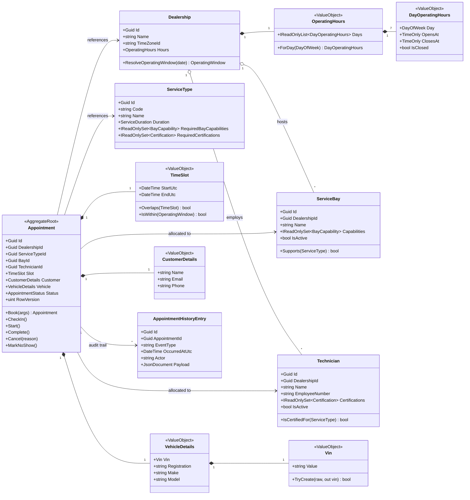
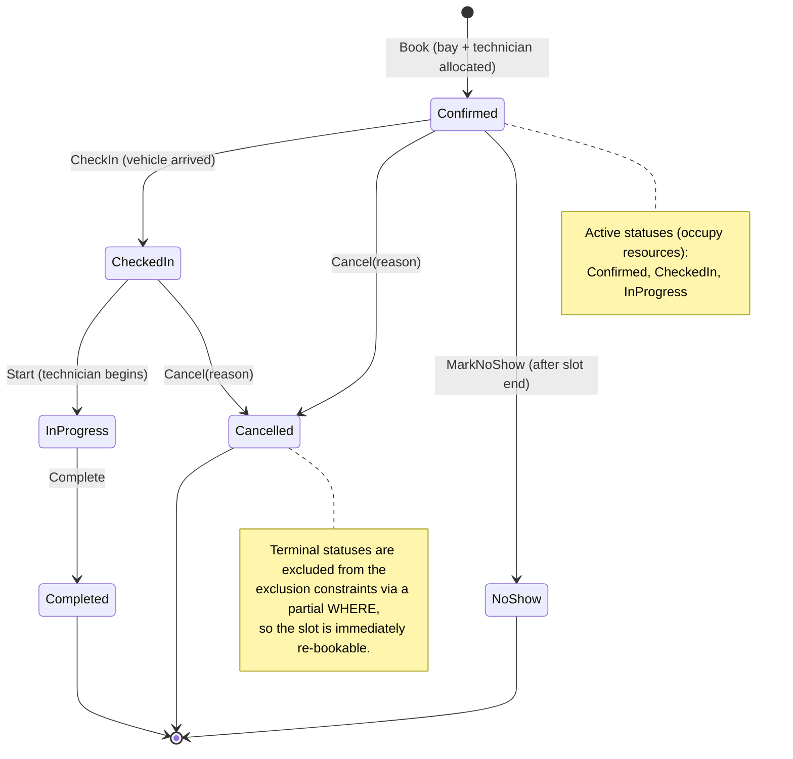
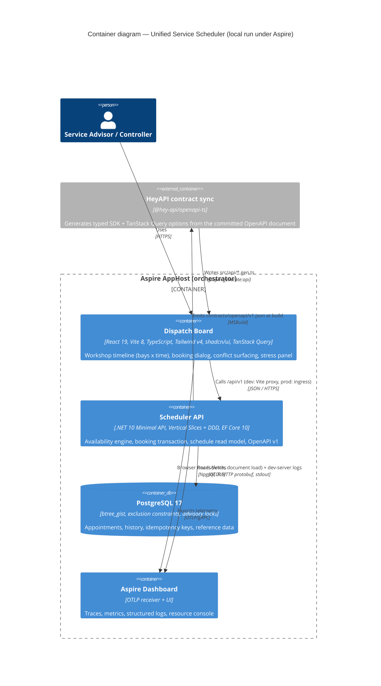
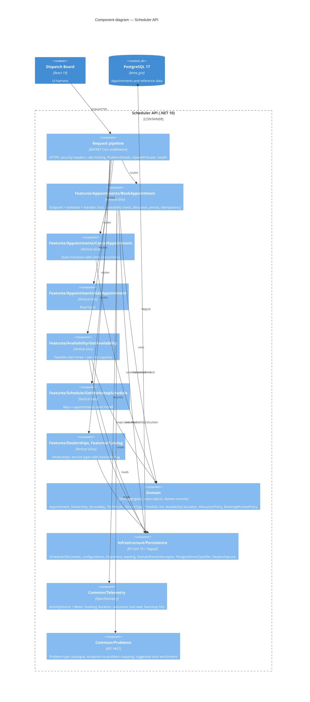
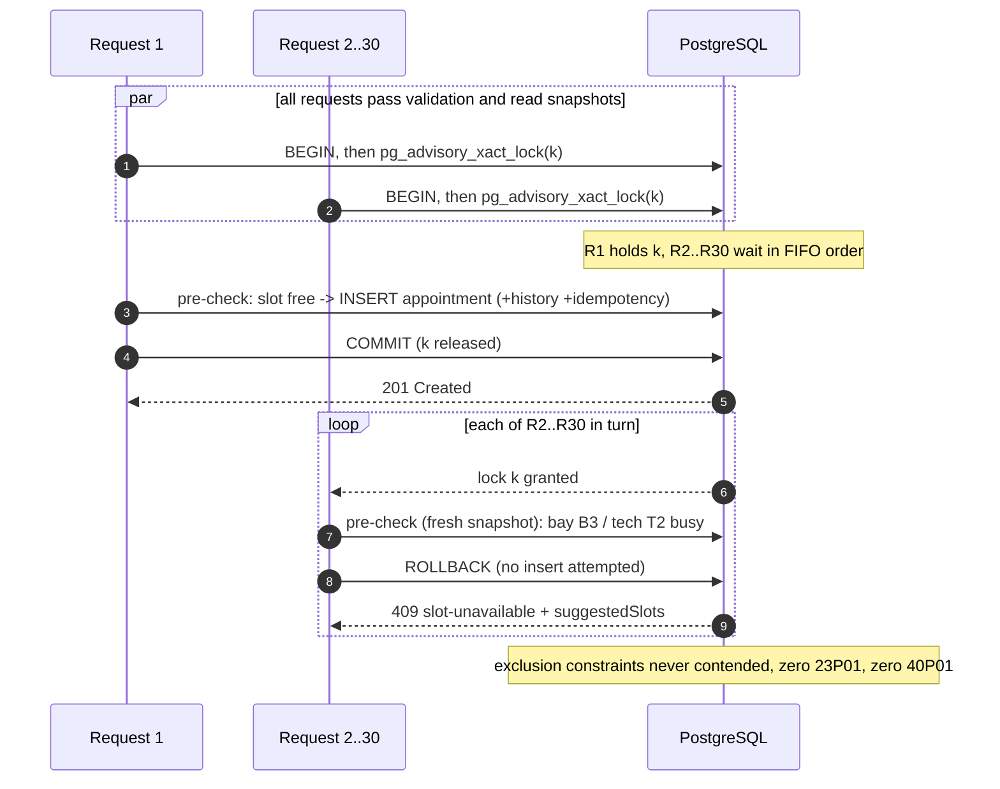
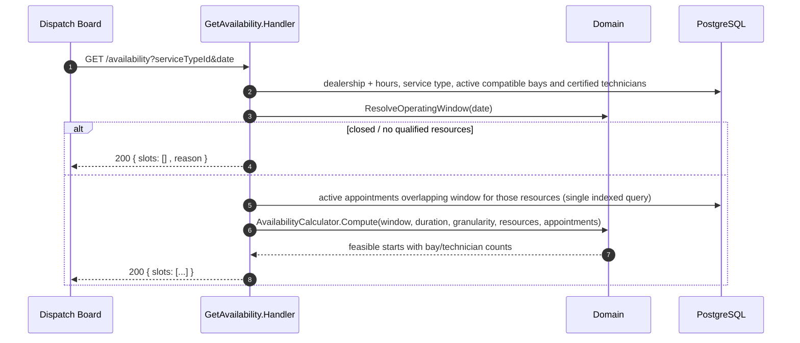
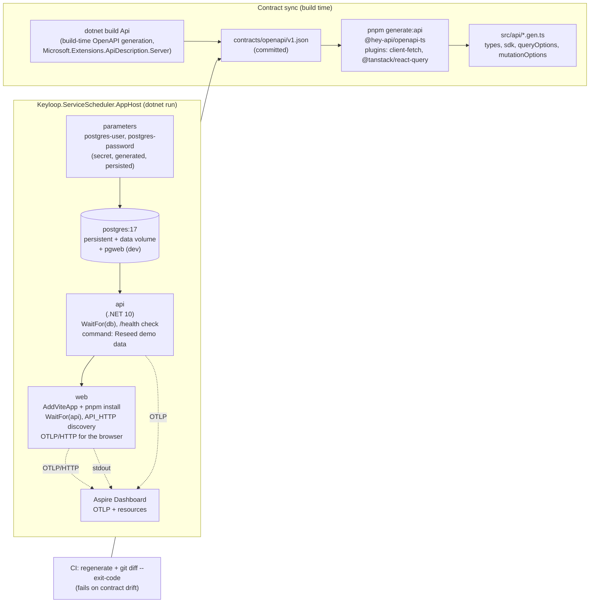
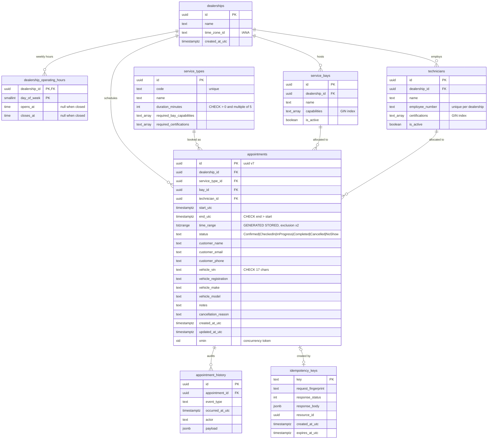
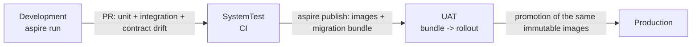
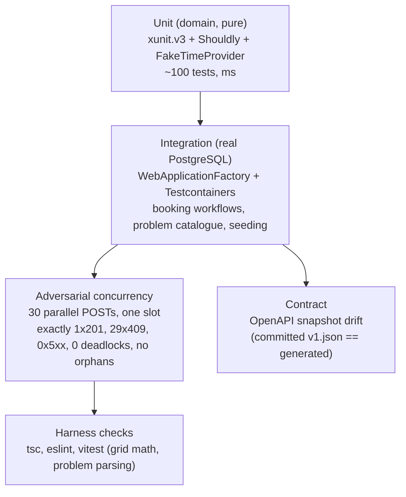

# Keyloop Unified Service Scheduler — System Design

| Field | Value |
|-------|-------|
| Scenario | Keyloop Technical Assessment, **Scenario A: The Unified Service Scheduler** (Domain: Ownership) |
| Implemented layer | **Backend** (.NET 10 Web API, PostgreSQL) — fully implemented and tested. Frontend is a high-fidelity dispatch-board harness that exercises the real API. |
| Status | v1.0 — approved for implementation |
| Date | 2026-10-11 |
| Author | Khai Pham (design directed by the author, co-produced with GenAI — see §16) |

**How to read this document.** §1–§4 frame the problem and the assumptions that resolve the brief's ambiguities. §5–§7 are the heart of the design: the domain model, the availability algorithm, and the concurrency strategy that guarantees zero double-bookings. §8–§9 are the architecture (C4 diagrams, slices, API contract, data model) and technology choices. §10–§14 cover environments, security, observability, reliability, and testing. §15 covers the UI harness, §16 records how GenAI was used, and §17–§18 close with risks and the Architecture Decision Record (ADR) log.

---

## 1. Executive summary

Dealership service lanes lose money two ways: **overbooking** (a bay or technician is promised twice) and **idle capacity** (a booking is refused when a compatible bay and a certified technician were actually free). Manual diaries and naive schedulers fail because a booking is a *multi-resource* decision — the right **ServiceBay** (EV-capable lift, heavy-duty bay, alignment rig) and a **Technician** holding the right **certifications** must both be free for the **entire** service duration, and many desks and online channels book concurrently.

This design delivers a booking engine whose correctness does not depend on application code being right:

1. **The database is the invariant of record.** Two PostgreSQL *exclusion constraints* (`EXCLUDE USING gist`) make it physically impossible to commit two active appointments that overlap on the same bay or the same technician.
2. **A per-dealership transaction-scoped advisory lock** serialises the check-then-insert window, so under peak contention requests queue for milliseconds and receive a clean, explainable `409 Conflict` instead of racing into the constraint — and, critically, instead of tripping PostgreSQL's deadlock detector (§7.3).
3. **An availability engine** computes feasible start times as a set intersection over per-resource free intervals, so the UI and the booking path share one definition of "available".
4. **Vertical slices + DDD**: each capability (`BookAppointment`, `GetAvailability`, `GetWorkshopSchedule`, `CancelAppointment`, …) is a self-contained folder holding its endpoint, request validation, handler, and persistence; the `Appointment` aggregate owns its state machine and emits domain events that are persisted as an audit trail in the same transaction.
5. **.NET Aspire 13** orchestrates PostgreSQL, the API, and the Vite frontend with one command, and OpenTelemetry carries traces, metrics (booking latency, contention rate, lock wait) and correlated logs into the Aspire dashboard.
6. **An adversarial test** fires 30 simultaneous bookings at one bay/technician/time and proves exactly one `201 Created`, twenty-nine `409 Conflict`, zero server errors, zero deadlocks, and no orphaned rows.

---

## 2. Business context and problem statement

### 2.1 Who uses it

| Actor | Goal | Channel |
|-------|------|---------|
| **Service advisor** (dealership desk) | Book a customer's vehicle for a service at a time the customer wants, with confidence that the slot is real | Dispatch board (this harness) / DMS |
| **Customer** | Book online without phoning the dealership | Online booking portal (future; same API) |
| **Workshop controller** | See the day's bay plan; spot gaps and overloads; cancel/move work | Dispatch board |
| **Technician** | Know what is allocated to them and when | Dispatch board (read-only) / future mobile |
| **Operations / SRE** | Keep the service healthy; diagnose conflicts and latency | Aspire dashboard / OTLP backend |

### 2.2 Core business invariants (from the brief, made precise)

| Id | Invariant | Precise statement |
|----|-----------|-------------------|
| **I-1** | Resource-constrained booking | An appointment is for one `Dealership`, one `ServiceType`, one `Vehicle` (VIN), and one half-open time slot `[start, end)` where `end − start = ServiceType.Duration`. |
| **I-2** | Multi-resource availability | An appointment can only be confirmed if it is assigned exactly one `ServiceBay` whose capabilities ⊇ `ServiceType.RequiredBayCapabilities` **and** exactly one `Technician` whose certifications ⊇ `ServiceType.RequiredCertifications`, and neither resource has any other *active* appointment overlapping `[start, end)`. |
| **I-3** | Zero double-booking under contention | For any bay `b` and any technician `t`, at any instant the set of active appointments assigned to `b` (resp. `t`) is pairwise non-overlapping — regardless of how many API instances or desks are writing, and without deadlocks. |
| **I-4** | Confirmed, persistent, auditable record | A confirmed appointment durably ties Customer, Vehicle VIN, Bay, Technician, ServiceType, and Timeslot together, and every state change is recorded. |
| **I-5** | Operating hours | An appointment must lie entirely within the dealership's operating window for that local date (and the dealership must be open that day). |

### 2.3 Non-goals for this vertical slice

Explicitly out of scope (each has a documented seam in §11.3 or §17): customer identity management / CRM, pricing and invoicing, parts availability, technician shift rosters and leave, multi-day jobs, rescheduling (modelled as cancel + re-book), notifications (email/SMS), online-payment holds, and a production identity provider integration.

---

## 3. Assumptions and scope decisions

The brief invites reasonable assumptions for ambiguous requirements. Each one below is numbered so reviewers can challenge it individually.

| Id | Assumption / decision | Rationale |
|----|------------------------|-----------|
| **A-1** | **Backend is the fully implemented layer**; the React dispatch board is a harness that exercises the real API, not a mocked frontend. | The brief asks for one layer; the harness demonstrates end-to-end behaviour on video without being the evaluated artefact. |
| **A-2** | **Customer and Vehicle are value objects owned by the Appointment** (name, phone, email; VIN, registration, make, model), not separate aggregates. | A CRM is out of scope; the invariant only needs the *association*. Promoting them to aggregates later is a non-breaking schema change (add FK columns, keep the snapshot). |
| **A-3** | **VIN validation is format-only** (17 characters, no I/O/Q, uppercase alphanumeric). The ISO 3779 check digit is *not* enforced. | The check digit is only mandatory in North America; European VINs frequently fail it. Validation is a value-object concern and can be tightened per market. |
| **A-4** | **Technicians work the dealership's operating hours.** Individual shifts, breaks and leave are not modelled. | Keeps the availability algorithm focused; the free-interval model (§6) extends to per-technician windows by swapping the initial "free" set. |
| **A-5** | **Operating hours are weekly** (per weekday open/close, or closed). Public holidays and ad-hoc closures are not modelled. | Same extension point as A-4 (a `DealershipClosure` override table). |
| **A-6** | **Slot granularity is 15 minutes**; service durations are catalogue-defined, positive, multiples of 5 minutes, and ≤ 8 hours. | Industry-typical; validated at the catalogue level so a zero-duration service can never exist (edge case from the brief). |
| **A-7** | **One bay and one technician per appointment, for the whole duration.** No bay-swapping mid-service, no multi-technician jobs. | Matches the brief's wording; multi-resource allocation generalises by adding resource classes to the same set-intersection. |
| **A-8** | **Allocation is automatic** (the engine picks the bay and technician) with optional *preferred* bay/technician hints that are honoured only if feasible. | The brief asks the UI to "witness automatic bay/technician allocation". |
| **A-9** | **Rescheduling = cancel + book.** Cancelled appointments are retained for audit and excluded from the overlap constraints. | Keeps the state machine small and the constraint partial (`WHERE status IN active`). |
| **A-10** | **Authentication/authorisation is designed but not wired** in this slice (§11.3). All endpoints are anonymous in Development and SystemTest; the audit trail carries an `actor` field ready for a principal. | The evaluated deliverable is the booking engine. A real deployment would front the API with Keyloop's OIDC identity; the seam is explicit and small. |
| **A-11** | **Time is stored in UTC**; each dealership carries an IANA time zone used for operating-hours resolution and display. | Avoids the two classic failures (ambiguous wall-clock storage and DST double-booking). |
| **A-12** | **Minimum lead time and booking horizon are configurable** (Development: 0 min / 90 days; Production: 60 min / 90 days). | The demo needs same-day bookings; production should not accept bookings "in two minutes". |
| **A-13** | **PostgreSQL 17** (Aspire's default image, pinned). Exclusion constraints and `btree_gist` have been stable since PostgreSQL 9.x. | No bleeding-edge dependency; `WITHOUT OVERLAPS` (PG 18) was considered and rejected because unique constraints cannot be partial. |
| **A-14** | **Seed data is deterministic in identity** (fixed GUIDs and names) and **relative in time** (sample appointments are placed in the upcoming week at seed time so the demo board is never empty). | Deterministic IDs make tests and demos repeatable; relative dates keep the dispatch board populated. |
| **A-15** | The reference clones (`references/`) are **not** committed; only MIT-licensed shadcn/ui components are vendored into the Web project. | MiroTalk is AGPL-licensed; copying it would taint the submission. Ideas were borrowed, code was not. |

---

## 4. Requirements

### 4.1 Functional requirements

| Id | Requirement | Slice |
|----|-------------|-------|
| FR-1 | List dealerships with time zone and operating hours. | `GetDealerships` |
| FR-2 | List the service catalogue for a dealership, flagging which services are *bookable* there (≥1 compatible active bay and ≥1 certified active technician exist). | `GetServiceTypes` |
| FR-3 | Return available start times for a service at a dealership on a given local date, with per-slot free bay/technician counts. | `GetAvailability` |
| FR-4 | Book an appointment: validate, resolve operating hours, allocate a bay and a technician, persist atomically, return `201` with `Location`. | `BookAppointment` |
| FR-5 | Reject a booking with a precise RFC 9457 problem (`400` input validation, `404` unknown references, `422` business-rule violation, `409` contention) and, on `409`, suggest the nearest alternative slots. | `BookAppointment` |
| FR-6 | Support an optional `Idempotency-Key` header so client retries of a successful booking replay the original `201` instead of creating a duplicate or returning a confusing `409`. | `BookAppointment` |
| FR-7 | Retrieve an appointment by id. | `GetAppointment` |
| FR-8 | Cancel an appointment with a reason; cancelled slots become bookable again; invalid transitions are rejected with `409`. | `CancelAppointment` |
| FR-9 | Return the workshop schedule for a dealership and local date: bays × appointments (with technician, vehicle, service, status) plus the technician roster — the dispatch-board read model. | `GetWorkshopSchedule` |
| FR-10 | Expose a versioned OpenAPI 3 document (`/openapi/v1.json`) and an interactive reference (Scalar) in non-production environments. | cross-cutting |
| FR-11 | Apply migrations and deterministic seed data automatically in Development/SystemTest. | infrastructure |

### 4.2 Quality attributes (non-functional requirements)

| Attribute | Target | How the design meets it |
|-----------|--------|-------------------------|
| **Consistency** | Zero double-bookings, ever, across any number of API replicas | DB exclusion constraints (§7.3) — correctness does not rely on application locks being honoured |
| **Contention behaviour** | 30 simultaneous requests for one slot → exactly 1 success, 29 `409`, 0 `5xx`, 0 deadlocks | Advisory lock serialises check-then-insert; constraint is the backstop; adversarial test (§14.4) |
| **Latency** | Booking p95 < 150 ms, availability p95 < 100 ms at single-dealership daily volumes (≈ 10–60 appointments/day) | One lock, two or three indexed queries, one insert; availability is O(A log A) in-memory over one indexed read |
| **Availability** | Stateless API; horizontally scalable; DB is the only serialisation point | No in-process state; locks are transaction-scoped in PostgreSQL |
| **Observability** | Every booking traceable end-to-end; conflict rate and lock wait visible as metrics | §12 |
| **Security** | Validated input, no information leakage, rate-limited mutations, secrets never in source | §11 |
| **Maintainability** | A new capability = one new folder; domain rules live in one place and are unit-tested | Vertical slices, DDD aggregates, analyzers, warnings-as-errors |
| **Testability** | Domain testable without a DB; integration tests against real PostgreSQL | Pure domain model; Testcontainers |
| **Portability** | One command to run the whole stack on any machine with Docker | Aspire AppHost |

---

## 5. Domain model

### 5.1 Ubiquitous language

| Term | Meaning |
|------|---------|
| **Dealership** | A physical site with a time zone, weekly operating hours, service bays and technicians. |
| **Service bay** | A physical workspace with a set of **capabilities** (e.g. `StandardLift`, `HeavyDutyLift`, `EvHighVoltage`, `WheelAlignment`, `Diagnostics`, `MotTesting`, `AirConditioning`). |
| **Technician** | A person with a set of **certifications** (e.g. `GeneralService`, `Brakes`, `HighVoltageElectrical`, `Diagnostics`, `MotTester`, `WheelAlignment`, `AirConditioning`, `HeavyVehicle`). |
| **Service type** | A catalogue entry: code, name, duration, *required* bay capabilities and *required* technician certifications (all-of semantics). |
| **Time slot** | A half-open UTC interval `[start, end)`. Two slots overlap iff `a.start < b.end && b.start < a.end`. Back-to-back slots do **not** overlap. |
| **Operating window** | The UTC interval a dealership is open on a given local date, derived from its weekly hours and time zone. |
| **Appointment** | The aggregate that binds dealership, service type, customer, vehicle, bay, technician and slot, with a lifecycle (§5.5). |
| **Active appointment** | An appointment in a status that occupies resources: `Confirmed`, `CheckedIn`, `InProgress`. |
| **Allocation** | The act of choosing a specific bay and technician for a booking. |
| **Availability** | The set of start times at which at least one compatible bay and one certified technician are both free for the whole duration. |

### 5.2 Bounded context and aggregate map

A single bounded context, **Workshop Scheduling**, with five aggregates. Catalogue and resource aggregates change rarely (reference data); `Appointment` is the high-churn transactional aggregate.



**Why `Appointment` references other aggregates by id only.** Aggregates are consistency boundaries; a booking must never load-and-lock the whole dealership graph. The engine reads bays and technicians as snapshots for allocation, and the only transactional writes are the appointment row, its history row, and (optionally) the idempotency row.

### 5.3 Why `DealershipSchedule` is a read model, not an aggregate

The brief lists `DealershipSchedule` as a candidate aggregate. We evaluated making it the root that owns all appointments for a dealership (or for a dealership-day):

| Option | Consequence |
|--------|-------------|
| **Schedule as aggregate** (owns appointments; booking = `schedule.Book(...)` with an optimistic version) | Every booking loads and version-bumps the same row ⇒ all desks contend on one optimistic token; under 30 concurrent requests, 29 retry and most fail again; the aggregate grows unboundedly. Correctness still depends on the application re-checking overlaps correctly. |
| **Appointment as aggregate + DB invariant** (chosen) | The overlap invariant is per *(resource, time range)*, which PostgreSQL enforces natively. Appointments are independent rows; contention is confined to the ~ms lock window. The schedule is a *projection* (`GetWorkshopSchedule`) over appointments. |

The dealership-day *is* still a meaningful unit — it is the key of the advisory lock (§7.3) — but it does not need to be an object we load and save.

### 5.4 Invariants and where each is enforced

Defence in depth: every invariant has a *primary* enforcement point and, where the stakes justify it, a *backstop*.

| Invariant | Primary enforcement | Backstop |
|-----------|---------------------|----------|
| Slot duration = service duration, `end > start` | `TimeSlot` + `Appointment.Book` factory | DB `CHECK (end_utc > start_utc)` |
| Bay capabilities ⊇ required | `AllocationPolicy` filters candidates; `Appointment.Book` re-asserts via `ServiceBay.Supports` | Integration test on `422 no-qualified-resources` |
| Technician certifications ⊇ required | same | same |
| No overlapping active appointments per bay | Pre-check inside advisory lock (§7.3) | **`EXCLUDE USING gist (bay_id WITH =, time_range WITH &&) WHERE status IN active`** |
| No overlapping active appointments per technician | same | **`EXCLUDE USING gist (technician_id WITH =, time_range WITH &&) WHERE status IN active`** |
| Within operating window, dealership open | `Dealership.ResolveOperatingWindow` + `TimeSlot.IsWithin` | n/a (not safety-critical) |
| Not in the past / lead time / horizon | `BookingWindowPolicy` (uses `TimeProvider`) | n/a |
| Valid state transitions | `Appointment` state machine | `xmin` concurrency token → `409 concurrency-conflict` |
| VIN format | `Vin` value object | DB `CHECK (vin ~ '^[A-HJ-NPR-Z0-9]{17}$')` |
| Every appointment has a history entry for creation | Domain event → interceptor writes row in same transaction | Integration test "no orphaned/missing history" |

### 5.5 Appointment lifecycle



Transition rules live in `Appointment` as explicit methods; an illegal call throws `InvalidStateTransitionException` which the API maps to `409 invalid-state-transition`. The API in this slice exposes `Book` and `Cancel`; the remaining transitions exist in the domain (and are unit-tested) so the model is complete even though the operational endpoints (check-in, start, complete) are future slices.

### 5.6 Domain events and the audit trail

| Event | Raised by | Persisted as | After-commit reaction |
|-------|-----------|--------------|------------------------|
| `AppointmentBooked` | `Appointment.Book` | `appointment_history` row (`event_type = Booked`, payload: slot, bay, technician, service, masked VIN — events carry no customer PII) | metrics `scheduler.booking.requests{outcome=confirmed}`; log |
| `AppointmentCancelled` | `Appointment.Cancel` | row (`Cancelled`, payload: reason, previous status) | metrics; log |
| `AppointmentCheckedIn` / `Started` / `Completed` / `NoShow` | respective methods | row | log |

Mechanism: aggregates collect events in a private list; a `SaveChangesInterceptor` drains them *before* the insert statements are flushed and materialises them as `AppointmentHistoryEntry` rows **inside the same transaction** (a lightweight transactional outbox). After a successful commit the interceptor dispatches the same events in-process to telemetry handlers. If a future requirement needs cross-service integration events, the history table already has the shape of an outbox (unprocessed flag + relay) — no new transactional surface is needed.

---

## 6. Availability and resource allocation

### 6.1 Formalisation

For a dealership `d`, service type `s`, and local date `D`:

- Operating window `W = [O, C)` in UTC, from `d.Hours` for the weekday of `D`, converted using `d.TimeZoneId` (§6.4). If the dealership is closed, `W = ∅` and availability is empty.
- Duration `Δ = s.Duration`; granularity `G` (15 min).
- Candidate start set `S = { O + kG : k ∈ ℕ, O + kG + Δ ≤ C }`.
- Resource classes: `B* = { b ∈ d.Bays : b.IsActive ∧ b.Capabilities ⊇ s.RequiredBayCapabilities }`, `T* = { t ∈ d.Technicians : t.IsActive ∧ t.Certifications ⊇ s.RequiredCertifications }`.
- For a resource `r`, busy set `Busy(r)` = union of slots of its *active* appointments intersecting `W`; free set `Free(r) = W \ Busy(r)` as a sorted list of disjoint half-open intervals.
- **Feasible start set** of `r`: `Φ(r) = { t : [t, t+Δ) ⊆ Free(r) }`. For each free interval `[a, b)` with `b − a ≥ Δ`, this contributes the *closed* interval `[a, b − Δ]` (the start `b − Δ` is valid because the slot ends exactly at `b`).
- **Availability**: `Avail = S ∩ ( ⋃_{b ∈ B*} Φ(b) ) ∩ ( ⋃_{t ∈ T*} Φ(t) )`.

The subtle point — and the reason a naive implementation is wrong — is that the union must be taken over *feasible-start sets*, not over free sets. A slot can be covered by the union of two bays' free time while neither bay is free for the whole duration. Shrinking each resource's free intervals by `Δ` *before* taking the union makes the intersection exact.

### 6.2 Algorithm

```
GetAvailability(d, s, D):
  W ← ResolveOperatingWindow(d, D)              // §6.4; may be empty
  if W = ∅ → return []
  B*, T* ← filter active resources by capability / certification
  if B* = ∅ or T* = ∅ → return [] (and the catalogue marks s as not bookable at d)
  appts ← one indexed query: active appointments of d whose range overlaps W,
          restricted to bay_id ∈ B* or technician_id ∈ T*
  for each r in B* ∪ T*:
      Busy(r) ← sorted, merged intervals of appts assigned to r
      Free(r) ← complement of Busy(r) within W
      Φ(r)    ← { [a, b−Δ] : [a,b) ∈ Free(r), b−a ≥ Δ }
  ΦB ← merge-union of Φ(b) over B*;  ΦT ← merge-union of Φ(t) over T*
  F  ← interval intersection of ΦB and ΦT
  return { t ∈ S : t ∈ F }  with, for each t, |{b : t ∈ Φ(b)}| and |{t' : t ∈ Φ(t')}|
```

**Complexity.** With `A` appointments that day and `R = |B*| + |T*|` resources: sorting `O(A log A)`, free/feasible sets `O(A + R)`, unions `O(A log R)`, intersection `O(A)`, enumeration `O(|S|)`. For realistic sizes (A ≈ 50, R ≈ 15, |S| ≈ 40) this is microseconds of CPU; the request cost is one indexed read. Per-slot counts (used by the UI as a capacity heat-map) are obtained by a pass over `S` that checks each resource's feasible-start intervals with a moving pointer: `O(|S| · R + A)`, still microseconds at workshop sizes.

**Worked example.** Window 08:00–12:00, `Δ` = 60 min, `G` = 15. Bay 1 busy 09:00–10:00; Bay 2 busy 08:00–09:30 and 10:30–11:00. Tech A busy 08:30–09:00; Tech B busy 10:00–12:00.
- `Φ(Bay1)` = [08:00, 08:00] ∪ [10:00, 11:00]; `Φ(Bay2)` = [09:30, 09:30] ∪ [11:00, 11:00] → `ΦB` = [08:00,08:00] ∪ [09:30,09:30] ∪ [10:00,11:00].
- `Φ(TechA)` = [09:00, 11:00]; `Φ(TechB)` = [08:00, 09:00] → `ΦT` = [08:00, 11:00].
- `Avail` = {08:00, 09:30, 10:00, 10:15, 10:30, 10:45, 11:00}. Note 08:15 is *not* available even though Bay 1 is free 08:00–09:00 and Tech B is free 08:00–10:00: Bay 1's feasible-start set ends at 08:00 because 08:15 + 60 min collides with its 09:00 job.

### 6.3 Allocation policy (which bay, which technician)

When a booking at start `t` is feasible, several bays/technicians may qualify. The policy is deterministic and tested:

1. **Honour a preferred resource** if supplied and feasible; otherwise ignore the hint (do not fail).
2. **Preserve specialised capacity**: choose the candidate with the *fewest surplus* capabilities/certifications beyond what the service requires (so a standard service does not consume the only EV bay).
3. **Balance load**: tie-break by the fewest active appointments that day.
4. **Determinism**: final tie-break by name, then id.

This is a greedy heuristic, not an optimiser; it is cheap, explainable to a workshop controller ("why did it pick Bay 3?"), and unit-tested. A global re-optimisation (bin-packing the day) is a separate capability and out of scope.

### 6.4 Time, time zones, and daylight saving

- **Storage**: all instants are `timestamp with time zone` in UTC; the .NET type is `DateTime` with `Kind = Utc` (Npgsql's non-legacy mapping). The API serialises ISO-8601 with `Z`.
- **Display strings**: every `…Local` field (`startLocal`, `endLocal`, `opensAtLocal`, `closesAtLocal`) is ISO-8601 local time to the minute *with the zone's offset at that instant* (`yyyy-MM-ddTHH:mm±hh:mm`, `LocalTimeConverter.FormatLocal`), e.g. `2026-10-13T10:00+01:00`. The offset keeps the repeated hour of a fall-back day unambiguous (Europe/London 2026-10-25: 00:30Z is `01:30+01:00`, 01:30Z is `01:30+00:00`) and parses back to the same instant; the `…Utc` field remains the identity.
- **Operating hours** are wall-clock `TimeOnly` values per weekday. `ResolveOperatingWindow(date)` converts `(date, opensAt)` and `(date, closesAt)` with `TimeZoneInfo.FindSystemTimeZoneById(ianaId)`:
  - a wall-clock time that **does not exist** (spring-forward gap, e.g. Europe/London 2026-03-29 01:00–02:00) is advanced to the first valid instant (01:30 → 02:00 BST = 01:00Z);
  - an **ambiguous** wall-clock time (autumn fall-back, 2026-10-25) resolves to the *earlier* instant (first occurrence, which carries the larger daylight-saving offset: 01:30 → 01:30 BST = 00:30Z, not 01:30 GMT = 01:30Z), matching the reference implementation reviewed during design.
  - Candidate start times are generated in UTC from `O`, so a DST day simply has an operating window that is one hour shorter or longer in absolute terms — slots are never duplicated or skipped.
- **Half-open intervals** everywhere (`[start, end)`), so 09:00–10:00 and 10:00–11:00 are adjacent, not overlapping. This is mirrored in the database range (`tstzrange(start_utc, end_utc, '[)')`).
- **Clock**: `TimeProvider` is injected (never `DateTime.UtcNow` inline), enabling deterministic tests of lead time, horizon and no-show logic with `FakeTimeProvider`.

### 6.5 Edge cases considered

| Case | Behaviour |
|------|-----------|
| Zero-duration or negative-duration service | Impossible: `ServiceDuration` value object rejects ≤ 0; DB `CHECK`. |
| Booking exactly at closing time minus duration | Allowed (slot ends at `C`, half-open). |
| Booking that would end after closing | `422 outside-operating-hours`. |
| Dealership closed on that weekday | `422 outside-operating-hours` (detail says "closed on Sundays"). |
| Start not aligned to granularity | `422 slot-not-aligned` (the UI only offers aligned slots; the API still validates). |
| Start in the past / inside lead time | `422 lead-time-not-met`. |
| Start beyond horizon | `422 beyond-booking-horizon`. |
| Service requires a capability no bay at the dealership has | `422 no-qualified-resources` (and the catalogue marks it not bookable). |
| All qualified resources busy at that time | `409 slot-unavailable` + `suggestedSlots`. |
| Race lost after pre-check (only possible for writers bypassing the lock) | `409 slot-conflict` (constraint backstop) + `suggestedSlots`. |
| Back-to-back bookings on the same bay | Allowed. |
| Same VIN booked twice at overlapping times | Allowed by the engine (a vehicle can only be in one place, but this is a *customer* mistake, not a resource conflict). Surfaced as a warning in the UI; a future rule could reject it. |
| DST transition days | §6.4; covered by unit tests on Europe/London 2026-03-29 and 2026-10-25. |
| Preferred bay supplied but incompatible | Hint ignored; allocation proceeds; response shows the chosen bay. |
| Cancel an already cancelled/completed appointment | `409 invalid-state-transition`. |
| Two advisors cancel the same appointment simultaneously | First wins; second gets `409 concurrency-conflict` (`xmin`). |
| Client retries a `POST` after a network timeout | With `Idempotency-Key`: replay `201` with `Idempotent-Replayed: true`. Without: the second attempt sees `409 slot-unavailable` (no duplicate is possible either way). |

---

## 7. Concurrency and data integrity

### 7.1 The hazard

Booking is *check-then-act*: read the schedule, decide a bay and technician are free, insert. Under `READ COMMITTED` two transactions can both pass the check and both insert — the classic **write skew / phantom** anomaly. Every strategy below is a way of closing that window.

### 7.2 Options evaluated

| Strategy | Mechanism | Correctness | Behaviour at 30 concurrent | Deadlock risk | Scale-out | Verdict |
|----------|-----------|-------------|-----------------------------|---------------|-----------|---------|
| **PostgreSQL exclusion constraint** (`EXCLUDE USING gist`, `tstzrange && `, `btree_gist`) | Index-enforced "no two rows overlap on the same key" | **Absolute** — holds for every writer, every replica, every bug | 1 commits; others fail at the index. *But* two inserters can each insert their index entry before checking and then wait on each other; PostgreSQL resolves this with its deadlock detector after `deadlock_timeout` (1 s) — the loser sees `40P01 deadlock_detected`, not `23P01` | Yes, when used **alone** under true simultaneity (§7.3) | Perfect | **Invariant of record** |
| **Pessimistic row locks** (`SELECT … FOR UPDATE` on bay and technician rows) | Serialise on parent rows | Correct only if **every** writer takes the same locks in the same order | 1 commits; 29 block then fail the re-check | Yes if lock order differs (bay→tech vs tech→bay); must be disciplined | Good | Rejected as *primary*: correctness depends on application discipline |
| **Optimistic concurrency token** (version on a schedule/day aggregate) | Compare-and-swap on a row version | Correct, but the "row" must cover the whole conflict set (dealership-day) | 1 commits; 29 retry; each retry re-reads and most fail again — retry storms, wasted work | None | Poor under hot spots | Rejected for booking; **adopted for state transitions** (`xmin` on `appointments`) where contention is per-row |
| **`SERIALIZABLE` isolation (SSI)** | Predicate-lock tracking, abort on dangerous structures | Correct | Many `40001 serialization_failure`; retry loops; false positives on hot pages | None (aborts instead) | Medium | Rejected: retry storms and unpredictable aborts under exactly the peak we must handle |
| **Transaction-scoped advisory lock per dealership** (`pg_advisory_xact_lock(key)`) | Application-chosen mutex inside the DB | Correct *for writers that take it*; cheap; released on commit/rollback automatically | 1 commits; 29 queue in FIFO order for ~ms each, each re-checks and returns `409` cleanly | **None** — a single lock per transaction cannot form a cycle | Good (per-dealership partitioning; refine to per-resource with sorted keys if ever needed) | **Serialisation mechanism** |
| **Single-writer queue** (actor/queue per dealership) | Move serialisation into the app | Correct if single instance; needs leader election for HA | Good | None | Complex | Rejected: reinvents what the DB lock gives for free |

### 7.3 Decision: exclusion constraints + advisory lock + optimistic token (each where it fits)

**Layer 1 — the invariant (always on).** Two partial exclusion constraints on `appointments`, over a *stored generated column* so the range can never drift from `start_utc`/`end_utc`:

```sql
CREATE EXTENSION IF NOT EXISTS btree_gist;

ALTER TABLE appointments
  ADD COLUMN time_range tstzrange
    GENERATED ALWAYS AS (tstzrange(start_utc, end_utc, '[)')) STORED;

ALTER TABLE appointments
  ADD CONSTRAINT ex_appointments_bay_no_overlap
    EXCLUDE USING gist (bay_id WITH =, time_range WITH &&)
    WHERE (status IN ('Confirmed', 'CheckedIn', 'InProgress'));

ALTER TABLE appointments
  ADD CONSTRAINT ex_appointments_technician_no_overlap
    EXCLUDE USING gist (technician_id WITH =, time_range WITH &&)
    WHERE (status IN ('Confirmed', 'CheckedIn', 'InProgress'));
```

`btree_gist` lets the GiST index combine the equality on the uuid with the overlap on the range. The partial `WHERE` means cancelled/completed/no-show rows neither block new bookings nor need to be deleted. These constraints are created in the EF Core migration via `migrationBuilder.Sql` (EF has no first-class exclusion-constraint API).

**Layer 2 — serialisation (the normal path).** `BookAppointment` runs this transaction, at the default `READ COMMITTED` isolation, after the lock-free checks (the idempotency-key lookup of §7.5 and the 404/422 rules) and after minting the appointment id once for the request:

```sql
BEGIN;
SELECT pg_advisory_xact_lock(:dealership_lock_key);           -- queue here, ms-scale
-- fresh snapshot per statement under READ COMMITTED ⇒ sees the previous holder's commit
SELECT ... FROM appointments WHERE id = :minted_id;           -- an earlier run of THIS request committed? answer with it (lost ack)
SELECT ... FROM idempotency_keys WHERE key = :key;            -- only with a key: live ⇒ replay or 422; expired ⇒ the DELETE below
DELETE FROM idempotency_keys WHERE key = :key AND expires_at_utc <= :now;   -- only for an expired row (§7.5)
SELECT ... active appointments of this dealership overlapping [start, end) ...;
-- in memory: feasibility + allocation (§6)
INSERT INTO appointments (id, ...) VALUES (:minted_id, ...);  -- cannot conflict: we hold the lock
INSERT INTO idempotency_keys (...) VALUES (...);              -- only if a key was supplied
INSERT INTO appointment_history (...) VALUES (...);           -- (the order EF Core sends them in)
COMMIT;                                                       -- lock released
```

The retrying execution strategy re-runs the whole transaction after a transient failure. A failure *during* `COMMIT` may be a lost acknowledgement of a commit that happened, so the strategy first asks whether the minted appointment exists (EF Core's `verifySucceeded`) and, if it does, answers with it instead of booking again; the existence check at the top of each run is a second guard behind that. Because the id is minted once per request, not once per run, a committed run is always recognisable.

Why this combination and not the constraint alone: PostgreSQL implements exclusion checks as *insert the index entry, then scan for conflicts, then wait for any in-progress conflicting transaction*. Two truly simultaneous inserters can each insert before either scans, then each waits on the other; the deadlock detector breaks the tie after `deadlock_timeout`, so one request stalls for a second and fails with `40P01` rather than `23P01`. The outcome is still exactly one winner — the invariant is never at risk — but it is slow and the error is semantically wrong. Taking the dealership lock first means at most one transaction is inside the check-then-insert window at a time, so the constraint is never contended in practice and remains a pure backstop.

Why `READ COMMITTED` matters: under `REPEATABLE READ` the snapshot is taken at the first statement — which is the lock acquisition itself — so a transaction that waited for the lock would still *read the pre-lock snapshot* and miss the previous holder's commit. `READ COMMITTED` takes a fresh snapshot per statement, which is exactly what check-then-act under a lock requires. This is asserted in code (the transaction is opened explicitly with `IsolationLevel.ReadCommitted`) and documented in ADR-004.

Why there can be no deadlock: each booking transaction acquires exactly one lock it waits for while holding nothing else (the dealership key), *before* any write, and the appointment insert is its only insert contended on the resources. A transaction waiting for the advisory lock holds no locks the holder could want; the holder's remaining work is non-blocking reads, inserts and a commit. The wait-for graph is a simple queue, not a graph that can contain a cycle. Two booking transactions for *different* dealerships interact only through the idempotency-key row, the scoped exception in ADR-003: the expired-key `DELETE` and the key `INSERT` can wait, but only on the *same key* being used at *another* dealership at the same moment. The waiter then holds only its own dealership's lock, which the transaction it waits for never requests, and a transaction inserts its key only after its own appointment insert has succeeded, after which it waits for nothing. So the wait cannot close a cycle either. The guard that keeps this true is in ADR-003: *a booking transaction must never acquire a second lock or perform a second contended insert, except on its own idempotency-key row*.

Lock key: a stable 64-bit value derived from the dealership id (`BitConverter.ToInt64(id.ToByteArray(), 0)`). The two-argument form `pg_advisory_xact_lock(namespace, hashtext(id::text))` would also work; the single `bigint` form is used for simplicity.

Lock granularity trade-off: a per-dealership lock serialises *all* bookings at a site. A busy site books tens to low hundreds of appointments per day; a critical section of ~2–5 ms yields capacity of hundreds of bookings per second per dealership — three orders of magnitude above demand. If a future multi-site tenant ever needed more, the refinement is two locks keyed on `(bay_id)` and `(technician_id)` acquired in *sorted key order* (which again cannot cycle). Noted in §17.

**Layer 3 — optimistic concurrency for state transitions.** `Cancel`, `CheckIn`, etc. update an existing row. PostgreSQL's system column `xmin` is mapped as the EF concurrency token (a `uint` property configured with `IsRowVersion()`, which Npgsql maps to `xmin` without creating a column), so two concurrent transitions on the same appointment resolve as first-writer-wins and `409 concurrency-conflict` for the loser. No lock is required because the conflict set is a single row.

### 7.4 Error classification

`PostgresException.SqlState` is classified in one place (`PostgresErrorClassifier`) and mapped to problem types:

| SQLSTATE | Meaning | Mapped to | Expected frequency |
|----------|---------|-----------|--------------------|
| `23P01` `exclusion_violation` (constraint name tells bay vs technician) | Overlap backstop fired | `409 slot-conflict` + suggestions; metric `scheduler.booking.constraint_backstop` | ≈ 0 (only out-of-band writers) |
| `40P01` `deadlock_detected` | Should be impossible on the booking path | `409 slot-conflict` (`conflictingResource: unknown`), when raised by the booking `SaveChanges` it is answered by the handler and **not** retried, although Npgsql calls it transient (a 40P01 from the lock acquisition, the expired-key `DELETE` or a read would reach the execution strategy and be retried; ADR-003 argues none can occur); **Warning** log (1004) + `scheduler.booking.deadlocks` so it is visible | 0 — asserted by the adversarial test |
| `40001` `serialization_failure` | Not used (READ COMMITTED) | transient → execution-strategy retry | 0 |
| `23505` `unique_violation` on `idempotency_keys` | Duplicate idempotency key | load stored response → replay `201` if same fingerprint, else `422 idempotency-key-reuse` | rare |
| `23514` `check_violation` | Domain guard bypassed | `500` (bug) with trace id | 0 |
| `DbUpdateConcurrencyException` (xmin) | Concurrent state transition | `409 concurrency-conflict` | rare |
| transient (`57P01`, `08xxx`, timeouts) | Infra blip | Npgsql execution strategy retries the whole unit of work (the lock is re-acquired because it is transaction-scoped). A failure during `COMMIT` is first verified (does the minted appointment exist?), so a lost acknowledgement is a success, not a second booking (§7.3) | rare |

### 7.5 Idempotent booking

`POST` is not idempotent by default; a client that times out after the server committed will retry and, without help, receive `409 slot-unavailable` for a booking it actually owns. The optional `Idempotency-Key` header (1–64 characters of `[A-Za-z0-9_-]`, e.g. a UUID; anything else is `400 validation-error` keyed `Idempotency-Key`) fixes this:

1. Compute `fingerprint = SHA-256(dealershipId + "\n" + canonical JSON body)` (the body re-serialised through the source-generated context, so formatting does not matter).
2. **Before any rule or availability check, without a lock**, read the key's row. Unexpired with the same fingerprint → replay the stored `201` body with `Location` and `Idempotent-Replayed: true`; unexpired with another fingerprint → `422 idempotency-key-reuse`; expired or missing → continue. This is what makes a sequential retry safe: it never reaches the availability check, where its own committed appointment would make the slot look busy, nor the lead-time rule, which time may since have broken.
3. **Inside the booking transaction, immediately after the dealership lock** (and the check for this request's own minted appointment, §7.3), read the row again with the same rules: a concurrent request with the same key may have committed while this one waited for the lock, and under `READ COMMITTED` this statement sees that commit. An expired row is deleted in this transaction, so the new row cannot collide with it.
4. Only then the availability re-check, allocation, and the inserts (appointment, history, `(key, fingerprint, 201, body, resource_id, expires_at = now + 24 h)`) and commit.
5. **Backstop**: a `23505` on `idempotency_keys` can now only mean the same key was used concurrently at *another* dealership (whose lock does not serialise with ours); the handler rolls back, re-reads the committed row and applies the rules of step 2 (the fingerprint includes the dealership, so the answer is `422`). A row that is already expired by this instance's clock (only possible when instances' clocks are a day apart) is not replayed: the key is free, so the booking runs once more and step 3 deletes the row.
6. **Only successful (`2xx`) outcomes are memoised**: any `4xx` booking rolled back its transaction (including the key row), so a failed booking may be retried with the same key. This keeps the design to one transaction and avoids memoising transient conflicts.

Why this cannot double-book or answer a retry with a wrong `409`: every request for a dealership checks the key and then availability *after* taking the dealership's lock, and each statement sees everything the previous lock holder committed. A same-key request therefore finds the earlier request's row before it can look at availability; a server-side retry of a run whose commit acknowledgement was lost finds its own minted appointment (with or without a key, §7.3); the exclusion constraints still forbid any overlap whatever the application does. The expired-key `DELETE` (step 3) takes a row lock on that key only, contended solely by the same key used at another dealership at the same moment; such a transaction waits holding only its own dealership's lock, which the holder never requests, so the wait cannot form a cycle (ADR-003).

Keys carry `expires_at` (24 h); purging is a scheduled job noted in §17. A retry after the 24 hours is a new booking.

---

## 8. Architecture

### 8.1 C4 — System context


### 8.2 C4 — Containers (with Aspire orchestration)



### 8.3 C4 — Components inside the Scheduler API



### 8.4 Vertical-slice layout and conventions

```
src/Keyloop.ServiceScheduler.Api/
├── Program.cs                         # composition root: ServiceDefaults, DbContext, slices, pipeline
├── Domain/                            # pure, no EF/ASP.NET references
│   ├── Common/        Entity, AggregateRoot, ValueObject, IDomainEvent, DomainException, Result
│   ├── Dealerships/   Dealership, OperatingHours, DayOperatingHours, OperatingWindow
│   ├── Resources/     ServiceBay, BayCapability, Technician, Certification
│   ├── Catalog/       ServiceType, ServiceDuration
│   └── Scheduling/    Appointment, AppointmentStatus, TimeSlot, Vin, CustomerDetails, VehicleDetails,
│                      AppointmentEvents, AvailabilityCalculator, AllocationPolicy, BookingWindowPolicy
├── Features/                          # one folder per capability; nothing shared across slices except Domain + Common
│   ├── Dealerships/GetDealerships/     GetDealershipsEndpoint, GetDealershipsHandler, DealershipResponse
│   ├── Dealerships/Mapping/            DealershipMapper (Mapperly; one mapper per feature family)
│   ├── Catalog/GetServiceTypes/        GetServiceTypesEndpoint, GetServiceTypesHandler, ServiceTypeResponse
│   ├── Catalog/Mapping/                ServiceTypeMapper
│   ├── Availability/GetAvailability/   Endpoint, Query, Validator, Handler, Response
│   ├── Appointments/BookAppointment/   Endpoint, Command, Validator, Handler, Response, IdempotencyGuard
│   ├── Appointments/GetAppointment/
│   ├── Appointments/CancelAppointment/
│   └── Schedule/GetWorkshopSchedule/
├── Infrastructure/
│   ├── Persistence/   SchedulerDbContext, Configurations/*, Migrations/*, Seeding/*, Interceptors/DomainEventInterceptor,
│   │                  DealershipLock, PostgresErrorClassifier, DatabaseInitializer (migrate + seed, env-gated)
│   └── Idempotency/   IdempotencyKey entity + store
├── Common/
│   ├── Endpoints/     IEndpoint + EndpointRegistry (explicit list, no discovery), route group /api/v1
│   ├── Validation/    ValidationFilter (FluentValidation -> 400 validation-error)
│   ├── Problems/      ProblemTypes, ProblemDetailsFactory, GlobalExceptionHandler
│   ├── Telemetry/     SchedulerTelemetry (ActivitySource, Meter, instruments)
│   └── Options/       SchedulingOptions, DatabaseOptions, SecurityOptions (validated on start)
├── appsettings.json / appsettings.{Development,SystemTest,UAT,Production}.json
└── Dockerfile                          # multi-stage, non-root, read-only FS friendly
```

Conventions:
- **No assembly scanning, no runtime code generation in our code.** Endpoints are listed in an explicit `EndpointRegistry`; handlers and validators are registered one by one; DTOs are listed in `SchedulerJsonContext`; mappers are Mapperly-generated (§9.1, ADR-016).
- **No mediator library.** Each slice registers its handler in DI and its endpoint calls it directly. MediatR moved to a commercial licence in 2025 and a hand-rolled dispatcher adds indirection without value here (ADR-001). Cross-cutting behaviour (validation, problem mapping, telemetry) lives in endpoint filters and middleware, not in a pipeline of behaviours.
- **Handlers own their persistence.** A slice queries `SchedulerDbContext` directly with projections; there is no generic repository. The domain stays persistence-ignorant via EF configurations.
- **Requests are records, validated by FluentValidation**; domain rules are enforced by the domain and surfaced as typed exceptions (`DomainRuleViolation` → `422`, `ResourceConflict` → `409`).
- **Responses are explicit DTO records** with `TypedResults` so the OpenAPI document is exact.

### 8.5 Data flow — sequence diagrams

**Booking, happy path**


**Booking under contention (30 simultaneous requests for the same slot)**



**Availability query**



### 8.6 Aspire orchestration and contract-sync pipeline



- **Run mode** (`dotnet run --project src/Keyloop.ServiceScheduler.AppHost`, or `aspire run`): Aspire generates the PostgreSQL credentials once (secret parameters persisted to the AppHost's user secrets), starts PostgreSQL as a persistent container with a named data volume (plus pgweb), waits for it, starts the API (which migrates and seeds in Development) and gates readiness on `/health`, installs the web dependencies (`pnpm install` as an installer child resource), regenerates the typed client from the committed contract (`predev`), and starts the Vite dev server with the API discovered through Aspire's `API_HTTP` variable; Vite proxies `/api/*`, `/openapi/*` and `/scalar/*` so the browser is same-origin (no CORS in development, ADR-012). The browser sends its own spans to the dashboard over OTLP/HTTP, so one trace runs from the click in the browser through the API to PostgreSQL. The dashboard exposes a *Reseed demo data* command on the API resource and links to Scalar and pgweb (ADR-019).
- **Publish mode** (`aspire publish`): produces deployment artefacts — API image from its Dockerfile, web image from its Dockerfile (nginx serving the static build and proxying `/api`), EF migration bundles for UAT/Production pipelines, and a Docker Compose definition (`docker-compose.yaml` + `.env` with the secret parameters as inputs) from the `compose` environment. The compose output runs the **Demo** environment (§10) so `docker compose up` works without the .NET SDK.
- **Contract sync**: `dotnet build` of the API emits the OpenAPI document into `contracts/openapi/v1.json` (committed) through build-time generation (`Microsoft.Extensions.ApiDescription.Server` runs the composition root against a mock server; a `GetDocument.Insider` guard skips database work). XML documentation comments become OpenAPI summaries, descriptions, response docs and request examples through the source generator built into `Microsoft.AspNetCore.OpenApi`. The Web project's `openapi-ts.config.ts` reads the committed file and generates `types.gen.ts`, `sdk.gen.ts`, `client.gen.ts` and `@tanstack/react-query.gen.ts` (`queryOptions`/`mutationOptions` per operation). CI builds, then fails on `git diff --exit-code contracts/` and on client drift; a parity test asserts the runtime document served in SystemTest equals the build-time file. Production never generates documents at runtime (ADR-008, ADR-017).

### 8.7 API contract

Base path `/api/v1`. JSON only; enums as strings; numbers as JSON numbers (never read from strings); instants ISO-8601 UTC. All errors are `application/problem+json` (RFC 9457, the successor of RFC 7807) with `traceId` (documented as a required member of the `ProblemDetails` schemas). Every route can also answer `429 rate-limited` with `Retry-After` (the global limiter, §11.2), and every operation documents it.

| Method & path | Purpose | Success | Errors |
|---------------|---------|---------|--------|
| `GET /dealerships` | List dealerships by name: `[{ id, name, timeZoneId, operatingHours[7]{ day, opensAt, closesAt } }]`, days Monday first, times `HH:mm` local, `null` when closed | `200` | `429` |
| `GET /dealerships/{dealershipId}/service-types` | The whole (global) catalogue by name: `[{ id, code, name, durationMinutes, requiredBayCapabilities[], requiredCertifications[], bookable }]`; `bookable` = the dealership has an active bay and an active technician that qualify | `200` | `404 not-found`, `429` |
| `GET /dealerships/{dealershipId}/availability?serviceTypeId=&date=YYYY-MM-DD` | Feasible start times for a local date (`date` strictly `yyyy-MM-dd`, from yesterday to the horizon) | `200` `{ date, timeZoneId, operatingWindow{startUtc,endUtc,opensAtLocal,closesAtLocal}, durationMinutes, slotGranularityMinutes, slots[{startUtc,endUtc,startLocal,freeBays,freeTechnicians}], unavailableReason }`; `operatingWindow` is `null` on a closed day; `unavailableReason` is `closed`, `no-qualified-resources` or `null` (slots may still be empty: fully booked, a service longer than that day's opening hours, or hours lost to a DST gap); `…Local` strings carry the offset (§6.4) | `400 validation-error`, `404 not-found`, `429` |
| `GET /dealerships/{dealershipId}/schedule?date=YYYY-MM-DD` | Dispatch-board read model: `{ dealership, operatingWindow, bays[{…, appointments[]}], technicians[] }` | `200` | `400`, `404`, `429` |
| `POST /dealerships/{dealershipId}/appointments` | Book `{ serviceTypeId, startUtc, customer{name,email,phone}, vehicle{vin,registration,make,model}, preferredBayId?, preferredTechnicianId?, notes? }` (headers: optional `Idempotency-Key`, 1–64 `[A-Za-z0-9_-]`); request bodies are limited to 64 KB (`413`) | `201` + `Location: /api/v1/appointments/{id}`, body `{ id, dealershipId, serviceType{id,code,name,durationMinutes}, bay{id,name}, technician{id,name}, startUtc, endUtc, startLocal, endLocal, status, customer, vehicle, notes, cancellationReason, createdAtUtc, updatedAtUtc }`; an idempotent replay returns the stored `201` plus `Idempotent-Replayed: true` (§7.5) | `400 validation-error` (body fields by JSON path, or `Idempotency-Key`), `404 not-found`, `422 outside-operating-hours / lead-time-not-met / beyond-booking-horizon / slot-not-aligned / no-qualified-resources / idempotency-key-reuse`, `409 slot-unavailable / slot-conflict`, `429` |
| `GET /appointments/{appointmentId}` | Read | `200` | `404`, `429` |
| `POST /appointments/{appointmentId}/cancel` | Cancel with `{ reason }` | `200` (updated appointment) | `400`, `404`, `409 invalid-state-transition / concurrency-conflict`, `429` |
| `GET /openapi/v1.json` · `GET /scalar/v1` | Contract and interactive reference (not in Production) | `200` | — |
| `GET /health` · `GET /alive` | Readiness (includes DB) and liveness | `200/503` | — |

**Problem type catalogue** (`type` is `https://api.keyloop.example/problems/{slug}`; the `.example` TLD is reserved for documentation):

| Slug | Status | When | Extensions |
|------|--------|------|------------|
| `validation-error` | 400 | Request shape/format invalid (FluentValidation) | `errors: { field: [messages] }` |
| `not-found` | 404 | Unknown dealership / service type / appointment | `resource`, `id` |
| `outside-operating-hours` | 422 | Slot not inside the operating window or dealership closed | `operatingWindow` (`{startUtc,endUtc}`), or `localDate` when the dealership is closed that day |
| `lead-time-not-met` | 422 | Start earlier than now + minimum lead time | `earliestStartUtc` |
| `beyond-booking-horizon` | 422 | Start later than now + horizon | `latestStartUtc` |
| `slot-not-aligned` | 422 | Start not on the granularity grid | `slotGranularityMinutes` |
| `no-qualified-resources` | 422 | Dealership has no active bay/technician that could ever serve this service | `missingCapabilities`, `missingCertifications`: what no active bay / technician has (empty on a side that qualifies); the `detail` text never names individual staff |
| `idempotency-key-reuse` | 422 | Same key, different request | — |
| `slot-unavailable` | 409 | All qualified resources busy at that time (pre-check) | `suggestedSlots[]`: up to `Scheduling:SuggestedSlotCount` bookable starts that day nearest the requested one, from active qualified resources, never the requested start |
| `slot-conflict` | 409 | Database overlap constraint fired (backstop) | `suggestedSlots[]`, `conflictingResource` (`bay`, `technician`, or `unknown` for a deadlock, which ADR-003 rules out) |
| `invalid-state-transition` | 409 | e.g. cancel a cancelled appointment | `currentStatus`, `attempted` (machine token: `cancel`, `check-in`, `start`, `complete`, `mark-no-show`) |
| `no-show-before-slot-end` | 422 | Marking a no-show before the slot has ended (domain rule; no endpoint in this slice) | — |
| `concurrency-conflict` | 409 | Row changed since read (`xmin`) | — |
| `rate-limited` | 429 | Policy exceeded | `retryAfterSeconds` |
| `internal-error` | 500 | Unhandled | `traceId` only — never exception details |

Framework-generated responses that never reach application code (an unknown route `404`, `405`, `413` request too large, `415`) keep the RFC 9110 `type` links that ASP.NET Core assigns; every problem raised by the application uses the catalogue base above.

The 400-vs-422 split is deliberate: `400` means "the request is malformed", `422` means "the request is well-formed but violates a business rule given current reference data", and `409` means "the request collides with current *state*". Clients can branch on `type` without parsing text.

### 8.8 Data model



Indexes that matter: `appointments (dealership_id, start_utc)` for day queries; the two GiST exclusion indexes double as overlap-search indexes (`bay_id = ? AND time_range && ?`); GIN on the capability/certification arrays for `@>` containment; `appointment_history (appointment_id, occurred_at_utc)`; `idempotency_keys (expires_at_utc)` for purging.

---

## 9. Technology choices and justification

| Concern | Choice (version) | Why | Alternatives considered |
|---------|------------------|-----|-------------------------|
| Orchestration | **.NET Aspire 13.6** (`Aspire.AppHost.Sdk`, `Aspire.Hosting.PostgreSQL`, `Aspire.Hosting.JavaScript`) | One-command local stack, service discovery, OTLP wiring, dashboard; first-class Vite support (`AddViteApp`) and publish-time Dockerfile/migration-bundle generation | docker-compose (no telemetry/dashboard, manual env plumbing) |
| Runtime / API | **.NET 10 (LTS)** Minimal APIs, `TypedResults`, built-in OpenAPI (`Microsoft.AspNetCore.OpenApi`) | Brief-mandated; minimal APIs fit vertical slices; built-in OpenAPI generator is accurate for `TypedResults` | Controllers + Swashbuckle (more ceremony, legacy generator) |
| Architecture style | **Vertical Slice + DDD** without a mediator | Each capability is independently readable and testable; domain owns invariants | Clean Architecture layers (more projects, more indirection for the same slice count); MediatR (now commercial) |
| ORM | **EF Core 10** + **Npgsql.EntityFrameworkCore.PostgreSQL 10.0.3** (via `Aspire.Npgsql.EntityFrameworkCore.PostgreSQL`) | Code-first migrations, LINQ projections, Npgsql's range/array support, `xmin` tokens, Aspire health/tracing integration | Dapper (hand-written SQL everywhere; fine for reads, poor for aggregates) |
| Database | **PostgreSQL 17** with `btree_gist` | Exclusion constraints give an index-enforced no-overlap invariant; advisory locks; `tstzrange` | SQL Server (no exclusion constraints; would need app-level serialisation as the primary mechanism) |
| Validation | **FluentValidation 12.2** via endpoint filter, validators registered explicitly (no assembly scanning) | Declarative, testable, produces field-level `400` problems; mandated by the brief | DataAnnotations (weaker composition); hand-written validators (would be fully AOT-clean) |
| Object mapping | **Mapperly 4.3** (source generator) | Build-time generated mappers, no reflection, unmapped members are build errors | AutoMapper (runtime reflection/expression compilation); hand-written mappers (reflection-free but boilerplate) |
| JSON | **System.Text.Json source generation** (`JsonSerializerContext`) with reflection disabled | AOT-safe, faster startup, missing types fail fast | Reflection-based STJ (default) |
| API test UI | **Scalar.AspNetCore 2.17** at `/scalar/v1` | Modern interactive client (request history, editable bodies prefilled from XML `<example>`s, code snippets), OpenAPI 3.1, dark mode; off in Production (ADR-018) | Swagger UI via `Swashbuckle.AspNetCore.SwaggerUI` 10.3 (familiar, older UX); ReDoc (read-only); `Scalar.Aspire` 0.11 (pre-1.0, extra container) |
| Telemetry | **OpenTelemetry 1.19** via ServiceDefaults + custom `ActivitySource`/`Meter`; `Npgsql.OpenTelemetry` | Vendor-neutral; Aspire dashboard locally, any OTLP backend in UAT/Prod | Application Insights SDK (vendor lock-in) |
| Resilience | `Microsoft.Extensions.Http.Resilience`; Npgsql execution strategy | Standard handlers; DB transient retries re-run the whole lock+check+insert unit | Polly direct |
| Testing | **xunit.v3 4.0**, **Shouldly 4.3**, **Testcontainers.PostgreSql 4.16**, `Microsoft.AspNetCore.Mvc.Testing`, `Microsoft.Extensions.TimeProvider.Testing` | Real PostgreSQL semantics for the concurrency proof; `FakeTimeProvider` for time rules | `Aspire.Hosting.Testing` (boots the whole AppHost — slower, used optionally for a smoke test) |
| Frontend | **React 19.3, Vite 8, TypeScript 6, Tailwind 4, shadcn/ui (Base UI), react-router-dom 7, react-hook-form + zod 4, TanStack Query 5.104** | Brief-mandated; matches the provided template's conventions exactly | — |
| Contract sync | **Build-time OpenAPI** (`Microsoft.Extensions.ApiDescription.Server` 10.0) + **XML-comment source generator** (`Microsoft.AspNetCore.OpenApi`) → **@hey-api/openapi-ts 0.99** with `@hey-api/client-fetch` and `@tanstack/react-query` plugins | Document produced by `dotnet build`, descriptions/examples compiled from XML comments, typed SDK and `queryOptions`/`mutationOptions` generated from the committed file; drift caught in CI | openapi-typescript + hand-written hooks; exporting the document from a test (earlier draft, replaced) |
| Package management | pnpm 12 (web), NuGet Central Package Management (`Directory.Packages.props`) | Single source of truth for versions; reproducible installs | — |

### 9.1 Runtime reflection budget and NativeAOT readiness

Direction added on 2026-10-11 (stakeholder request): prefer build-time source generation over runtime reflection and runtime code generation, and stay on the NativeAOT-compatible subset of the framework without yet targeting `PublishAot`. The budget below is explicit and measured by `scripts/aot-readiness.sh` (trim/AOT analyzer warning counts, published as a CI artefact).

| Concern | Mechanism chosen | Reflection at runtime? | Notes |
|---------|------------------|------------------------|-------|
| Request dispatch (minimal APIs) | **Request Delegate Generator** (`EnableRequestDelegateGenerator`) | No | Endpoint delegates are compiled at build time; a non-interceptable endpoint is a build error under warnings-as-errors. |
| Endpoint discovery | Explicit `EndpointRegistry` (one line per slice) | No | Replaces assembly scanning for `IEndpoint` implementers. |
| JSON (requests, responses, idempotency bodies, audit payloads) | **System.Text.Json source generation** (`SchedulerJsonContext`, `UseStringEnumConverter`), `JsonSerializerIsReflectionEnabledByDefault=false` | No | Any type missing from the context fails fast and is caught by the integration suite. |
| Object mapping | **Mapperly** (`Riok.Mapperly`, build-time generator, `RequiredMappingStrategy.Target`) | No | Unmapped target members are build errors. |
| Mediator / handler pipeline | None (ADR-001) | No | Nothing to replace; endpoints call handlers directly. |
| Configuration binding | **Configuration binding source generator** (`EnableConfigurationBindingGenerator`) | No | `BindConfiguration` calls are intercepted at build time. |
| Options validation | **`[OptionsValidator]` source generator** | No | Replaces `ValidateDataAnnotations()` reflection. |
| Logging | **`[LoggerMessage]` source generator**, stable event ids | No | No interpolated log calls in product code. |
| Regex | **`[GeneratedRegex]`** | No | VIN rule. |
| DI container | `Microsoft.Extensions.DependencyInjection`, explicit registrations only | Constructor discovery at startup (AOT-compatible) | Microsoft ships no source-generated container; third-party generators (Jab, Pure.DI) would replace the container under ASP.NET Core hosting — rejected as high risk for negligible gain. |
| Input validation | FluentValidation, validators registered explicitly | Expression trees compiled at first use (interpreted under AOT) | Mandated by the brief; no assembly scanning. Residual item in the budget. |
| ORM | EF Core 10 + Npgsql (AOT-compatible driver) | Model building and LINQ translation | Residual item. Next steps when needed: `dotnet ef dbcontext optimize` (compiled model; documented with its silent-drift caveat — not adopted for a 7-entity model) and precompiled queries once they leave preview. |
| OpenAPI document | **Build-time generation** (`OpenApiGenerateDocumentsOnBuild`) + **XML-comment source generator** | Production: none (no runtime document). Non-production: runtime `MapOpenApi()` for live Scalar; document transformers read parameter attributes (`[DataType]`, `[Description]`) while a document is generated, never on request paths | `Microsoft.AspNetCore.OpenApi` is NativeAOT-compatible; Scalar (non-production only) serves static assets. |
| Telemetry | OpenTelemetry .NET (AOT-compatible) | No | — |

See ADR-016.

---

## 10. Environments and configuration

Four environments share one codebase; behaviour differs only by configuration, never by `#if`.

| Concern | **Development** (local, Aspire run) | **SystemTest** (CI, integration tests) | **UAT** | **Production** |
|---------|-------------------------------------|----------------------------------------|---------|----------------|
| `ASPNETCORE_ENVIRONMENT` | `Development` | `SystemTest` | `UAT` | `Production` |
| Database | Aspire-managed `postgres:17` container, named volume | Testcontainers `postgres:17` per test session | Managed PostgreSQL | Managed PostgreSQL, HA |
| Migrations | Applied by the API on startup (`Database:MigrateOnStartup=true`) | Applied by the test fixture | **EF migration bundle** executed by the pipeline before rollout (`aspire publish` → `efmigrations/`) | Same; never at app startup |
| Seed data | Reference data + sample appointments for the coming week (`Database:SeedDemoData=true`) | Tests seed their own fixtures | Reference data only (via DMS sync later) | None |
| Scalar / OpenAPI UI | On | On | On, behind network policy | **Off** (`/openapi/v1.json` still served to internal CI only via ingress rule) |
| Error detail | Developer exception page off; ProblemDetails with `traceId` only (same as prod — no surprises later) | Same | Same | Same |
| Rate limiting | Permissive (`Booking: 120/min/IP`) | **Disabled** (tests must not trip it) | Production values | `Booking: 30/min/IP`, `Global: 300/min/IP` |
| Lead time / horizon | 0 min / 90 days | 0 / 90 | 60 min / 90 days | 60 min / 90 days |
| HTTPS / HSTS | Dev certificate; HSTS off | Off | TLS at ingress; HSTS on | TLS at ingress; HSTS on |
| Telemetry export | Aspire dashboard (OTLP injected by AppHost) | None (in-memory exporters in tests) | OTLP collector → vendor | OTLP collector → vendor; sampling 100 % traces at this volume |
| Secrets | Aspire parameters + user-secrets (`postgres-password` generated) | Testcontainers-generated | Key vault / env vars injected by platform | Key vault; DB auth via managed identity or rotated secrets |
| Secret source | AppHost user secrets (generated on first run; nothing typed by hand) | Testcontainers credentials per run | Platform secret store → parameters | Platform secret store → parameters (rotated) |
| DB role | Single dev role | Single role | `scheduler_app` (DML only); migrations run as owner | Same, least privilege |

Configuration sources (last wins): `appsettings.json` → `appsettings.{Environment}.json` → environment variables (Aspire injects `ConnectionStrings__schedulerdb`, `OTEL_*`) → user-secrets (Development only). All strongly-typed options are validated with `ValidateOnStart()` by `[OptionsValidator]` source-generated validators (§9.1) so a misconfigured deployment fails fast at boot rather than at first request, before any migration or seeding; a validation failure is logged as event `1103 StartupValidationFailed` (Critical: options type and the validators' member-prefixed messages, never values of secrets), any other configuration failure, such as a value the binder cannot convert, as `1104 StartupConfigurationFailed` (Critical: exception type and message with the unconvertible value removed), and the log exporters are flushed before the process exits.

A fifth environment, **Demo**, exists only for the Aspire-published Docker Compose bundle: UAT's security posture (rate limits on, Scalar on, no secrets in files) with migrations and demo seeding at startup and HSTS off because compose serves plain HTTP. It is a convenience for evaluators without the .NET SDK, not a deployment target.



---

## 11. Security

### 11.1 Threat model (STRIDE-lite)

| Threat | Vector | Mitigation in this slice | Residual / deferred |
|--------|--------|---------------------------|---------------------|
| **Spoofing** | Unauthenticated callers book/cancel | Deferred (A-10): OIDC bearer auth seam (§11.3) | Must be wired before any non-demo deployment |
| **Tampering** | Malformed payloads, type confusion, oversized bodies | FluentValidation; strict JSON (`System.Text.Json`, unknown enum values rejected); 64 KB request body limit; all SQL via parameterised EF/Npgsql (no interpolation) | — |
| **Repudiation** | "I never cancelled that" | `appointment_history` with `actor`, timestamp, payload, in the same transaction | `actor` becomes the authenticated principal once auth is wired |
| **Information disclosure** | Stack traces, connection strings in errors; PII in logs | ProblemDetails never carries exception details; `traceId` only; customer PII (name, email, phone) is never logged — logs use appointment id and a masked VIN (last 6) | PII encryption at rest is a platform concern (TDE) |
| **Denial of service** | Booking floods, availability scraping | ASP.NET rate limiter (sliding window per client IP; stricter policy on `POST`); bounded availability window (one day per call); advisory lock critical section is ms-scale | WAF / per-tenant quotas at the edge |
| **Elevation of privilege** | Cross-dealership access | All queries are scoped by `dealershipId` in the route; once auth is wired, a policy asserts the token's dealership claims contain the route id | — |
| **Supply chain** | Vulnerable packages | Central Package Management with pinned versions; `dotnet list package --vulnerable` and `pnpm audit` in CI; Dependabot config | — |
| **Secrets in source** | Connection strings committed | Aspire parameters marked `secret: true`; user-secrets; `.gitignore` guards; no secrets in `appsettings*.json` | — |

### 11.2 Controls implemented

- Security headers middleware: `X-Content-Type-Options: nosniff`, `Referrer-Policy: no-referrer`, `Cache-Control: no-store` on API responses, `Permissions-Policy` minimal; HSTS outside Development.
- CORS: default-deny; allowed origins come from configuration (`Security:AllowedOrigins`, exact http(s) origins only — `*` fails startup) and are empty in Development because the Vite proxy keeps the browser same-origin.
- Rate limiting: named policies `global` and `booking`, partitioned per client IP, `429` with `rate-limited` problem and `Retry-After` (also for clients that do not accept JSON); health probes are exempt.
- Forwarded headers: behind the TLS-terminating ingress (UAT/Production, `Security:ForwardedHeaders`), `X-Forwarded-For`/`X-Forwarded-Proto` are honoured as the first middleware, from configured `KnownProxies`/`KnownNetworks` only and for the last hop only, so rate-limit partitions, the audit actor and HTTPS redirection see the client. Enabling it without a trusted proxy or network fails startup (the framework would otherwise trust any peer). UAT and Production enable it but ship both lists empty, so startup fails until the platform supplies the ingress addresses (e.g. `Security__ForwardedHeaders__KnownNetworks__0=10.0.0.0/24`): a shipped default would be unsafe to override, because configuration arrays merge by index and an override of entry 0 keeps the remaining entries trusted.
- Input hardening: VIN, email, phone, name length limits; GUID route constraints; date parsing restricted to `yyyy-MM-dd`.
- Build hardening: `<Nullable>enable</Nullable>`, `<TreatWarningsAsErrors>true</TreatWarningsAsErrors>`, `<AnalysisLevel>latest-recommended</AnalysisLevel>`, `<EnforceCodeStyleInBuild>true</EnforceCodeStyleInBuild>`.
- Container hardening: multi-stage Dockerfile, non-root user, no SDK in the runtime image, health check.
- Database: migrations are the only DDL path; the application never runs with superuser in UAT/Production (documented role split).

### 11.3 Designed but deferred: authentication and authorisation

The seam is three lines in `Program.cs` and one attribute per endpoint group:

```csharp
// Program.cs — only when Security:Authority is configured (UAT/Production)
builder.Services.AddAuthentication().AddJwtBearer(o => { o.Authority = cfg.Authority; o.Audience = "scheduler-api"; });
builder.Services.AddAuthorizationBuilder()
    .AddPolicy("Scheduler.Read", p => p.RequireAuthenticatedUser())
    .AddPolicy("Scheduler.Book", p => p.RequireClaim("scope", "scheduler.book"))
    .AddPolicy("Scheduler.Cancel", p => p.RequireClaim("scope", "scheduler.cancel"))
    .AddPolicy("Dealership.Member", p => p.AddRequirements(new DealershipMemberRequirement())); // route dealershipId ∈ token claims
```

Endpoint groups declare `.RequireAuthorization("Scheduler.Book")` etc. In Development/SystemTest, `Security:Authority` is unset and a clearly logged *anonymous mode* is active; the `actor` on history rows is `"anonymous:<client-ip>"`. This keeps the demo frictionless while making the production posture explicit rather than implicit.

---

## 12. Observability

### 12.1 Signals

**Traces** (`ActivitySource "Keyloop.ServiceScheduler"`), nested under the ASP.NET Core server span:

| Span | Tags | Notes |
|------|------|-------|
| `scheduler.book_appointment` | `dealership.id`, `service_type.code`, `booking.requested_start_utc`, `booking.outcome` (`confirmed`, `replayed`, `slot_unavailable`, `slot_conflict`, `rule_violation`, `not_found`, `idempotency_reuse`, or `error` for an unexpected failure answered `500 internal-error`; `validation_failed` never reaches the handler, so it appears only on the metric), `booking.bay_id`, `booking.technician_id`, `idempotency.replayed` | the business transaction |
| `scheduler.acquire_dealership_lock` | `dealership.id`, `lock.wait_ms` | shows queueing under contention |
| `scheduler.compute_availability` | `availability.candidates_bays`, `availability.candidates_technicians`, `availability.slots_returned` | shared by availability and booking |
| `scheduler.persist_appointment` | `db.rows_affected` | wraps `SaveChanges` |
| Npgsql / EF spans | SQL text (parameters redacted), duration | automatic via Aspire integration |

**Metrics** (`Meter "Keyloop.ServiceScheduler"`):

| Instrument | Type | Unit | Tags | Why |
|------------|------|------|------|-----|
| `scheduler.booking.requests` | counter | `{request}` | `outcome` (the span's values plus `validation_failed`, counted by the endpoint's outer filter; `error` for an unexpected failure, a 500), `dealership.id` | throughput and **contention failure rate** (`slot_unavailable + slot_conflict` / total) |
| `scheduler.booking.duration` | histogram | `ms` | `outcome` | booking latency SLO (p95 < 150 ms); real elapsed time (`Stopwatch`), like every latency here, never the injected business clock |
| `scheduler.booking.lock_wait` | histogram | `ms` | `dealership.id` | queueing depth; a rising p95 means a hot dealership |
| `scheduler.booking.constraint_backstop` | counter | `{event}` | `constraint` | should stay at 0; non-zero means an out-of-band writer |
| `scheduler.booking.deadlocks` | counter | `{event}` | — | must stay at 0 (asserted by test; alert if > 0) |
| `scheduler.availability.duration` | histogram | `ms` | `dealership.id` | read-path latency |
| `scheduler.availability.slots_returned` | histogram | `{slot}` | — | capacity signal for the business |
| `scheduler.appointments.cancellations` | counter | `{appointment}` | `previous_status` | business metric |
| Runtime, ASP.NET Core, HTTP client, Npgsql pool | built-in | — | — | via ServiceDefaults |

A request the framework cannot bind at all (a body that is not JSON, a `413`) never reaches the booking endpoint's filters or handler, so it has no booking outcome: it is visible as `http.server.request.duration` with `http.response.status_code` 400 (or 413) on the booking route, and `GlobalExceptionHandler` answers it.

**Logs**: structured via `ILogger` + OpenTelemetry logging (`IncludeScopes`, `IncludeFormattedMessage`). Source-generated `LoggerMessage` definitions with stable event ids (`1001 BookingConfirmed`, `1002 BookingRejected`, `1003 ConstraintBackstopFired`, `1004 DeadlockDetected`, …). Scopes carry `DealershipId`, `AppointmentId`, `IdempotencyKey`. PII is never logged (§11.1). EF Core's own `SaveChangesFailed` and `CommandError` are lowered to Information: a refused insert is usually an answered outcome (a backstop is 1003 at Warning, a reused key a 1002), and an unexpected failure is still logged at Error by `GlobalExceptionHandler` (1200). EF's report of a failed commit (`TransactionError`) stays at Error: that is an infrastructure fault even when the commit is then verified as done.

### 12.2 Correlation

- W3C `traceparent` is honoured on inbound requests and propagated to PostgreSQL spans; the ASP.NET Core `Activity` id is written into every log line (trace id + span id) and into `ProblemDetails.extensions.traceId`.
- The dispatch board shows the `traceId` on error toasts, so a reviewer can paste it into the Aspire dashboard's trace search during the demo.
- The browser is a first-class trace participant: the dispatch board's OpenTelemetry web SDK (fetch and document-load instrumentation, plus `ui.book_appointment` and `ui.stress_test` spans) exports to the dashboard over OTLP/HTTP, and `traceparent` propagates on the same-origin `/api` calls, so the click, the API span tree and the SQL statements share one trace id. The OTLP API key is exposed to the browser only in Development; production builds ship with browser telemetry off unless a secret-free collector URL is configured.
- Frontend requests include an `X-Request-Id` (uuid) that the API echoes; the Vite console logs it for the harness's stress panel.

### 12.3 Health, SLOs and alerts

| Signal | Threshold | Action |
|--------|-----------|--------|
| `/alive` | process responsive | restart |
| `/health` | DbContext can connect (`CanConnect`) + migrations applied | remove from load balancer |
| `scheduler.booking.duration` p95 | > 300 ms for 5 min | page: check lock wait and DB |
| `scheduler.booking.deadlocks` | > 0 | page: invariant of ADR-003 violated by a code change |
| `scheduler.booking.constraint_backstop` | > 0 | investigate out-of-band writer |
| `http.server.request.duration{status=5xx}` | > 0.1 % | investigate |

### 12.4 What to look at during the demo

1. Resources page: `postgres`, `pgweb`, `api`, `web` (and its pnpm installer) healthy; `api` links to Scalar and offers the *Reseed demo data* command.
2. Traces: one `POST …/appointments` → `scheduler.book_appointment` → `acquire_dealership_lock` → `compute_availability` → `persist_appointment` → Npgsql `INSERT`.
3. After the stress panel fires 30 bookings: 30 traces, one with `booking.outcome=confirmed`, 29 with `slot_unavailable`, and `lock_wait` rising across them; metrics page shows `scheduler.booking.requests` by outcome and `deadlocks = 0`.
4. Structured logs filtered by `AppointmentId`.

---

## 13. Reliability and scalability

- **Stateless API**: any number of replicas; no sticky sessions; no in-memory locks. The database is the single serialisation point by design, and it is the one component that already has to be highly available.
- **Hot-spot analysis**: contention is per dealership. With a ~2–5 ms critical section, one dealership sustains hundreds of bookings/s — far above the tens/day of real demand. Cross-dealership requests do not interact.
- **Read path**: availability and schedule are read-only, cheap, and can be served from a read replica (they tolerate replica lag because booking re-validates under the lock on the primary). `Cache-Control: no-store` today; a short (5 s) per-dealership-day response cache with invalidation on booking is a documented optimisation.
- **Connection pooling**: Npgsql pool (default 100) with `MaxPoolSize` tuned per replica count in UAT/Prod; the pool is observed via the Npgsql metrics.
- **Graceful shutdown**: ASP.NET host drains in-flight requests; transaction-scoped locks are released by the server on connection close, so a crash mid-booking cannot leave a stuck lock.
- **Migrations**: additive-first policy (expand/contract), bundles executed before rollout. The exclusion constraints are created directly because the table is new; a future constraint on a large existing table would use `CREATE INDEX CONCURRENTLY` followed by `ADD CONSTRAINT … USING INDEX` to avoid a long lock.
- **Backups and retention**: platform-managed PITR; history and idempotency tables have purge jobs (§17).
- **Failure modes**: DB unavailable → `/health` fails, bookings return `503` (ProblemDetails) via the execution strategy exhausting retries; never a partial write because every booking is one transaction.

---

## 14. Testing strategy



### 14.1 Domain unit tests (no database)

`TimeSlot` overlap/adjacency, half-open semantics; `ServiceDuration` rejects zero/negative/non-multiple-of-5/over 8 h; `Vin` format (valid, 16 chars, contains `I`/`O`/`Q`, lowercase normalised); `OperatingHours.ResolveOperatingWindow` incl. closed day, DST spring-forward (Europe/London 2026-03-29) and fall-back (2026-10-25); `BookingWindowPolicy` lead time and horizon with `FakeTimeProvider`; `AvailabilityCalculator` — empty day, fully booked, back-to-back, the §6.2 worked example, the "union of free sets is wrong" counter-example, duration longer than any gap, per-slot counts; `AllocationPolicy` — preferred hint honoured/ignored, surplus-capability preference, load tie-break, determinism; `ServiceBay.Supports` / `Technician.IsCertifiedFor` — mismatch and superset cases; `Appointment` state machine — every legal transition, every illegal one, `Cancel` reason required, events raised exactly once; validators for every request.

### 14.2 Integration tests (Testcontainers PostgreSQL 17)

One container per test session; each test class gets a fresh schema via migrations + `Respawn`-style reset. `WebApplicationFactory<Program>` with the connection string overridden, `SystemTest` environment (rate limiting off, seeding off). Coverage: migrations apply cleanly from empty; seed is idempotent; availability endpoint equals the domain calculator for a seeded day; booking happy path (`201`, `Location`, history row, allocation shown); every problem type in §8.7 is reachable and well-formed; idempotency replay and key reuse; cancel then re-book same slot; `xmin` conflict via two contexts; **constraint backstop**: raw SQL insert of an overlapping row bypassing the lock → `23P01` → classifier → `409 slot-conflict`; OpenAPI document contains all operations and problem responses.

### 14.3 Why Testcontainers + WebApplicationFactory rather than Aspire.Hosting.Testing

The concurrency proof must hit a *real* PostgreSQL (exclusion constraints and advisory locks have no in-memory equivalent), and it must be fast and hermetic in CI. `Aspire.Hosting.Testing` boots the whole AppHost (including the Vite app) which is slower and brings unrelated failure modes; it is kept as an optional smoke test (`[Trait("Category","Aspire")]`) that asserts the composed application starts and `/health` returns healthy.

### 14.4 Adversarial concurrency test (the brief's acceptance criterion)

Fixture: a dedicated dealership with **exactly one** bay holding `EvHighVoltage` and **exactly one** technician holding `HighVoltageElectrical`; service "EV Battery Health Check" (60 min). Thirty distinct customers/VINs all request 10:00 tomorrow. The test releases all 30 `POST`s simultaneously (`Task.WhenAll` after a `Barrier`/`TaskCompletionSource` gate) through the in-memory test server against the real container.

Assertions:
1. Exactly one response is `201 Created`; its `Location` resolves to an appointment with the expected bay/technician.
2. Exactly twenty-nine responses are `409` with `type ∈ { slot-unavailable, slot-conflict }`, valid `application/problem+json`, `traceId` present, and a non-empty `suggestedSlots`.
3. Zero responses are `5xx`; the test's captured logs contain no unhandled exceptions and **no** `DeadlockDetected` (event 1004) entries; the `scheduler.booking.deadlocks` counter is 0 (read via an in-memory metrics exporter).
4. Database: exactly one active appointment overlaps the slot for that bay and for that technician; `COUNT(appointment_history) == 1` for that appointment; no history rows reference a missing appointment; no idempotency rows reference a missing appointment.
5. Repeat the whole scenario 5× in a loop to catch flakiness (the lock makes it deterministic; the repeat guards the claim).

A second variant removes the advisory lock (via a test-only option) to *demonstrate* why it exists: the invariant still holds (one `201`), but the loser set may now include `slot-conflict` and the test records whether any `40P01` surfaced — this variant is informational and documents the design trade-off rather than gating the build.

### 14.5 Frontend harness checks

`tsc --noEmit`, `eslint`, `vitest` for `time-grid.ts` (UTC slot → grid column mapping across DST), `problem-details.ts` (type → UI message/field mapping), and the stress-panel tally reducer. The generated client is never hand-edited (CI drift check). Visual QA in a real browser (Chrome, via claude-in-chrome) covers layout, both themes, two viewports, keyboard focus and console/network cleanliness (§15).

### 14.6 Continuous integration

GitHub Actions (`.github/workflows/ci.yml`): restore/build with warnings-as-errors → unit tests → integration + concurrency tests (Docker available on `ubuntu-latest`) → `dotnet list package --vulnerable` → contract regeneration + `git diff --exit-code` → `pnpm install --frozen-lockfile`, lint, typecheck, vitest, build. Test results and coverage (`coverlet`) are uploaded as artefacts.

---

## 15. Dispatch board (UI harness)

Purpose: demonstrate end-to-end booking, schedule visualisation and conflict handling on video. It consumes only the generated client.

- **Shell**: the template's `BaseLayout` (sidebar, header, theme provider, mode toggle) trimmed to one navigation group: *Dispatch Board*, *Appointments*. Unused template apps (mail, chat, tasks, auth pages, landing) are not vendored.
- **Toolbar**: dealership selector, date picker (defaults to today in the dealership's zone), *Book appointment* button, auto-refresh toggle (TanStack `refetchInterval: 5000` + refetch on focus), legend of statuses.
- **Timeline matrix**: CSS grid, rows = bays (sticky left column with capability badges), columns = 15-minute slots across the operating window; appointment blocks span `grid-column: start / end`, coloured by status, showing service name, VIN (monospace), technician badge (initials avatar + name). Technician-lane view toggle (rows = technicians) reuses the same block component. Hover shows a tooltip; click opens a details sheet with *Cancel*.
- **Booking dialog**: service type (shows duration, required capabilities/certifications and `bookable`), date, then available start times fetched from `GET /availability` rendered as chips with free-bay/technician counts; customer and vehicle fields (VIN validated client-side with the same rule as the server); optional preferred bay/technician. On `201` the dialog closes, the new block pulses on the board and a toast shows the allocated bay/technician. On `409` an inline alert shows the problem title/detail, `traceId`, and `suggestedSlots` as one-click chips; on `400/422` field errors map onto the form from `errors`/`type`.
- **Stress panel** (the video's proof moment): fire N (default 30) parallel bookings for one chosen slot from the browser and tally responses by status/type live — "1 × 201 · 29 × 409 slot-unavailable · 0 × 5xx" — with each row linking its `traceId`.
- **Error surfaces**: every non-2xx is parsed as ProblemDetails by one helper; unknown shapes fall back to a generic toast with status code.
- **Design direction and quality bar**: "calm control room" — neutral surfaces, one accent, colour reserved for appointment state (dedicated status tokens, AA contrast in both themes, never colour-only), Inter with tabular numbers, monospace VINs; a KPI strip (appointments today, bay utilisation, technicians busy now, next free slot); hatched out-of-hours time and a live "now" line; loading, empty and error states for every view; keyboard-reachable blocks with descriptive labels; reduced-motion support. The full checklist is in Addendum B §B4 of the implementation plan.
- **Visual QA**: after the harness is built, it is driven in Chrome (light/dark, 1440 and 1024 px) through every flow; console and network logs must be clean; findings are fixed and re-validated; screenshots and GIFs are committed under `docs/media/` for the README and the video.

---

## 16. GenAI co-design record

The brief makes the *process* of directing and verifying GenAI a primary evaluation criterion. This section records how GenAI was used for the design phase (the implementation narrative continues in the README's *AI Collaboration Narrative*).

**Tooling and roles.** Design, architecture and planning were produced in a single Claude Code session with **Claude Fable 5.1** acting as principal architect under my direction; implementation is delegated to **Claude Opus / Sonnet** subagents working from the written plan, with Fable reviewing their output. Documentation for current library APIs was pulled live through the Context7 MCP server (Aspire 13 `AddViteApp`/`AddEFMigrations`, HeyAPI plugin configuration, Npgsql range mapping) so the design cites real signatures, not training-data memories. An `Explore` subagent mined the reference repositories and reported a digest with file:line evidence rather than pasting code into the design context.

**How the model was steered.** I supplied the business framing, the mandated stack, the folder structure, and the success criteria (including the 30-request adversarial test), and asked for a design *before* any code. The session began by reading the official brief (PDF), inventorying the template's actual conventions (Base UI, Tailwind v4, TS 6, Vite 8), and pinning every package version from NuGet/npm — a deliberate guard against the model inventing APIs.

**Alternatives the model generated and how they were decided.**

| Topic | Options surfaced | Decision and reasoning |
|-------|------------------|------------------------|
| Concurrency primary mechanism | Exclusion constraint alone; `FOR UPDATE`; optimistic token; `SERIALIZABLE`; advisory lock; single-writer queue | Exclusion constraints as invariant **plus** a per-dealership advisory lock. The model initially proposed "exclusion constraint + candidate-retry loop"; stress-testing that proposal against PostgreSQL's insert-then-check implementation surfaced the mutual-wait → `40P01` path, which the brief's "without deadlocking" clause makes unacceptable. The lock removed it and also made the pre-check authoritative, which deleted the retry loop. |
| Isolation level for the booking transaction | `REPEATABLE READ` (model's first instinct, "safer") vs `READ COMMITTED` | `READ COMMITTED`: under RR the snapshot predates the lock acquisition, so a queued transaction would read stale state. This is the kind of subtle inversion that is easy to get wrong and is now an ADR with a test. |
| `DealershipSchedule` aggregate | Aggregate owning appointments vs read model | Read model; the aggregate version would turn every booking into an optimistic retry storm. |
| Mediator | MediatR vs hand-rolled vs none | None: minimal API endpoints call handlers directly; MediatR's licence change removed the "free convention" argument. |
| Migrations | Aspire `AddEFMigrations` + `RunDatabaseUpdateOnStart`, separate MigrationService project, API-startup migrate | API-startup in Dev/ST (fewest moving parts for `dotnet run`), **migration bundles** in UAT/Prod; the prescribed solution layout is preserved. `Aspire.Hosting.EntityFrameworkCore` was additionally found to be preview-only on NuGet at design time (13.6.1-preview), which rules it out for a production-grade submission. |
| 400 vs 422 | Everything-is-400 vs semantic split | Split (ADR-011) so clients branch on `type`. |
| Contract sync | Generate from the live URL at dev time vs exporting from a contract test vs build-time generation | Build-time generation into the committed `contracts/openapi/v1.json` with a `GetDocument.Insider` guard, plus a runtime-parity test; the first draft exported from a test because MSBuild-time emission starts the host — the stakeholder's prompt to look for source generation led to re-checking the .NET 10 docs, which document the guard for exactly this case. |
| API test UI and UI quality | Scalar vs Swagger UI vs ReDoc; visual QA by screenshots only vs driving the real UI in a browser | Scalar (interactive client, 3.1, examples from XML comments). The UI is validated by driving it in Chrome (claude-in-chrome): flows, both themes, two viewports, console/network checks, recorded GIFs for the video (§15). |
| CORS vs proxy in dev | Allow-list the Vite origin vs Vite proxy | Proxy (same-origin), CORS default-deny with configurable origins for other deployments. |
| Reflection reduction / AOT readiness (added mid-implementation at the stakeholder's request) | Source-generated DI containers (Jab, Pure.DI) vs explicit MEDI registrations; EF compiled models now vs later; Mapperly vs hand mappers; mediator source generators | Explicit MEDI registrations (Microsoft ships no DI generator; MEDI is AOT-compatible); compiled models deferred with the drift caveat; Mapperly adopted; no mediator exists to replace. The model inventoried every reflection site in the design and produced the budget table in §9.1. |

**Edge cases the model was asked to stress-test** (and that became tests): DST days, half-open adjacency, union-of-free-sets fallacy (§6.1), duration longer than any free gap, closing-time boundary, cancelled rows and the partial constraint, retry after timeout (idempotency), concurrent cancels (`xmin`), out-of-band writers (constraint backstop), lock re-acquisition under transient retry.

**Verification of the design itself.** Every Mermaid diagram was syntax-checked before commit; every API claimed in §9 was confirmed against live documentation or the installed toolchain (`dotnet 10.0.100`, `aspire 13.6`, `node 22`, Colima-backed Docker); the mirotalk booking module's DST tests were used as an independent reference for the time-zone rules. Nothing from the AGPL reference was copied (A-15).

---

## 17. Risks, open questions, and extension points

| Item | Impact | Plan |
|------|--------|------|
| Technician shifts, breaks and leave (A-4) | Availability over-promises technicians who are off | Add `technician_shifts` (per date/day-of-week windows); seed `Free(t)` from the shift window instead of the dealership window — a one-function change in the calculator. |
| Public holidays / closures (A-5) | Bookings on closed days | `dealership_closures` override table checked in `ResolveOperatingWindow`. |
| Bay turnaround buffers | Back-to-back jobs with no clean-up gap | Second generated range `bay_range = tstzrange(start, end + buffer)` with its own exclusion constraint. |
| Per-dealership lock becomes hot (multi-site tenants) | Latency under extreme load | Two advisory locks keyed by bay and technician, acquired in sorted key order (cycle-free). |
| Idempotency and history growth | Table bloat | Scheduled purge (`expires_at` / retention policy) as a hosted service or platform job. |
| Authentication not wired (A-10) | Cannot deploy beyond demo | §11.3 seam; estimated effort < 1 day with an existing OIDC authority. |
| Same-VIN double booking | Customer confusion | Add a domain rule (`422 vehicle-already-booked`) if the business confirms it should be hard-blocked. |
| Real-time board updates | Polling every 5 s | SSE/SignalR fan-out from the after-commit domain event dispatcher. |
| Remaining reflection (EF Core model/LINQ, FluentValidation expressions) | Blocks `PublishAot` | EF compiled model (`dotnet ef dbcontext optimize`, with a CI drift check) and precompiled queries once stable; replace FluentValidation with hand-written validators if the brief's mandate is lifted. |
| Exclusion constraint on a large existing table (future migration) | Lock on build | `CREATE INDEX CONCURRENTLY` then `ADD CONSTRAINT … USING INDEX`. |

---

## 18. Architecture Decision Records

| ADR | Decision | Context → Consequence |
|-----|----------|------------------------|
| **ADR-001** | Vertical slices with direct handler invocation; no mediator | Fewer moving parts; cross-cutting via filters/middleware; MediatR licence change. Consequence: handlers are plain classes, trivially unit-testable. |
| **ADR-002** | `Appointment` is the transactional aggregate; `DealershipSchedule` is a read model | Consistency boundary is (resource, range), enforced by the DB. Consequence: no hot aggregate; schedule is a projection. |
| **ADR-003** | Exclusion constraints are the invariant of record; a per-dealership transaction-scoped advisory lock serialises check-then-insert; **a booking transaction must never take a second lock or perform a second contended insert**, with one scoped exception: its own idempotency-key row (the expired-key `DELETE` and the key `INSERT`, §7.5), which can be contended only by the *same* key used at *another* dealership | Removes the insert-then-check mutual wait (`40P01`); makes the pre-check authoritative. The exception cannot form a cycle: a waiter on the key row holds only its own dealership's lock, which the transaction it waits for never requests, and the key insert comes after that transaction's own appointment insert. Consequence: `23P01` is a backstop metric that should read 0; a `40P01` is reported (1004), never retried. |
| **ADR-004** | Booking transaction runs at `READ COMMITTED`, opened explicitly | Per-statement snapshots are required for check-after-lock correctness. Consequence: never raise isolation for this path; a test asserts behaviour. |
| **ADR-005** | UTC storage; IANA time zone per dealership; half-open intervals; `TimeProvider` injected | Deterministic DST behaviour; testable time rules. |
| **ADR-006** | Capabilities/certifications are C# enums persisted as `text[]` with GIN indexes | Compile-time safety + OpenAPI enums + `@>` containment queries. |
| **ADR-007** | Migrations run at API startup only in Development, SystemTest and the compose-only Demo environment; UAT/Production use EF migration bundles produced by `aspire publish` | Preserves the prescribed solution layout; production never migrates at boot. |
| **ADR-008** | OpenAPI document generated at build time into `contracts/openapi/v1.json` (committed); HeyAPI generates the client from the file; CI fails on drift; a parity test checks runtime == build-time | Deterministic contract sync reviewable in PRs; production needs no runtime document generation. |
| **ADR-009** | `Idempotency-Key` memoises successful bookings only, inside the booking transaction | One transaction; failures are safe to retry. |
| **ADR-010** | Authentication/authorisation deferred with an explicit seam and anonymous-mode logging | Keeps the evaluated engine in focus; production posture documented. |
| **ADR-011** | Problem type catalogue: 400 malformed, 422 business rule, 409 state conflict; RFC 9457 | Clients branch on `type`; no text parsing. |
| **ADR-012** | Vite dev proxy for same-origin API access; CORS default-deny with configured origins | No CORS complexity in development; production via ingress. |
| **ADR-013** | Testcontainers + `WebApplicationFactory` for integration/concurrency tests; `Aspire.Hosting.Testing` optional smoke | Real PostgreSQL semantics, fast and hermetic. |
| **ADR-014** | GUID v7 primary keys | Index locality without exposing sequence; generated in the domain. |
| **ADR-015** | Domain events persisted as `appointment_history` rows in the same transaction (lightweight outbox) | Audit trail is atomic with the change; integration events can relay from the same table later. |
| **ADR-016** | Prefer build-time source generation over runtime reflection: RDG, STJ source generation with reflection disabled, Mapperly, configuration-binding and options-validator generators, `[LoggerMessage]`, explicit endpoint/DI/validator registration; keep MEDI as the container; FluentValidation and EF Core are the measured residue | Stakeholder direction (2026-10-11). Consequence: missing JSON registrations and unmapped DTO members are build/test failures; `scripts/aot-readiness.sh` tracks the residue; `PublishAot` is not enabled yet. |
| **ADR-017** | OpenAPI descriptions come from XML documentation comments (compile-time source generator); handlers are static method groups so comments attach; request properties carry `<example>`s; a request body is described by `[Description]` on its parameter | Docs live next to code with zero runtime cost; Scalar's test requests are prefilled with valid data. The 10.0 generator copies every `<param>` that names no operation parameter onto the request body, so a document transformer restores the body parameter's `[Description]` (and fails generation without one). |
| **ADR-018** | Scalar is the API test UI (`/scalar/v1`), enabled outside Production | Best interactive client among Scalar/Swagger UI/ReDoc for .NET 10; linked from the Aspire dashboard and the dispatch board. |
| **ADR-019** | Aspire is the whole development platform: generated secret parameters persisted to user secrets, persistent PostgreSQL + pgweb, health-gated startup, automatic `pnpm install`, Aspire service discovery (`API_HTTP`) for the Vite proxy, browser OTLP to the dashboard, a dashboard *Reseed demo data* HTTP command, `Aspire.Hosting.Testing` whole-stack smoke test, and `aspire publish` to Docker Compose | One command bootstraps all three tiers with correlated telemetry; deployment artefacts come from the same model as the dev loop. |

---

*End of document.*
