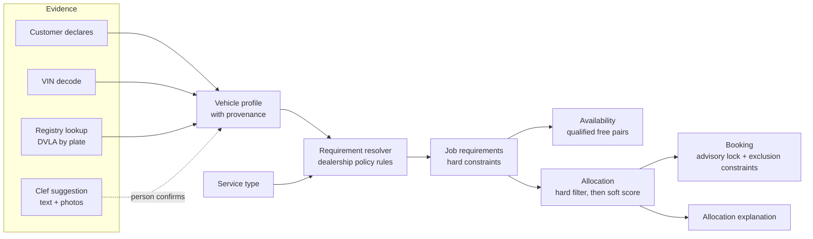
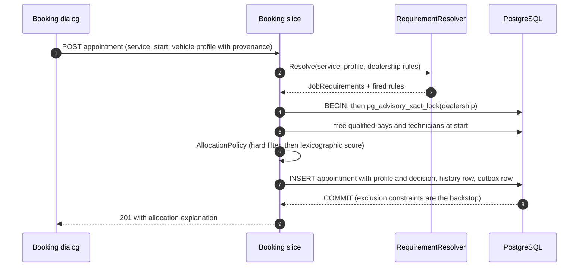

# ADR-029: Vehicle-aware requirements and explainable allocation ("AI proposes, rules decide")

| | |
|---|---|
| **Status** | Accepted (2026-10-12). Scope approved for build: Phases 0 and 1, plus the Clef powertrain suggestion once the Clef migration has merged (see "Decisions taken at acceptance") |
| **Deciders** | Khai Pham (product owner); design drafted with Claude Opus 5.5 |
| **Builds on** | ADR-001 (vertical slices), ADR-002 (Appointment aggregate), ADR-003 (lock + exclusion constraints), ADR-006 (capabilities as enums), ADR-016 (reflection budget), ADR-026 (closed-set triage with Jev) and ADR-028 (the move to Clef, in progress), ADR-027 (Access + roles, in progress) |
| **Touches** | Domain (requirements, allocation), availability and booking slices, intake triage, reference data, the dispatch board, telemetry |

## At a glance

Today a job's requirements depend only on its **service type**. A brake job needs a standard lift and a Brakes-certified technician, whether the car is a 2009 diesel or a 2026 battery-electric SUV. That is wrong in a way that matters: work on high-voltage (HV) vehicles requires HV-trained people, warranty work often requires brand-trained people, and a heavy van needs a heavy-duty lift whatever the job is.

This ADR makes requirements a function of **(service type, vehicle, dealership policy)**, keeps allocation **deterministic and explainable**, and gives the AI a precise, bounded role: it **proposes** facts about the vehicle and the job when the customer has not given them, with calibrated confidence, and a person confirms them. The AI never chooses a technician and never relaxes a hard constraint.



## Context

### What the model does today

- `ServiceType` carries `RequiredBayCapabilities` and `RequiredCertifications` (ADR-006). `ServiceBay.Supports(serviceType)` and `Technician.IsCertifiedFor(serviceType)` are subset checks.
- `AvailabilityCalculator` intersects the free time of qualified bays and qualified technicians. `AllocationPolicy` then picks one bay and one technician: the preferred one if it is free, otherwise the fewest surplus capabilities (keep specialists free), then the lowest load that day, then name and id.
- PostgreSQL enforces "no double booking" with two partial GiST exclusion constraints, and the booking transaction serialises per dealership with an advisory lock (ADR-003). None of this changes in this ADR.
- Intake triage (ADR-026, moving to Clef in ADR-028) chooses one service and an optional day from a closed set, with calibrated confidence and a human confirmation step.

### The gap, on the seeded Reading workshop

**Seed amendment, 2026-10-12:** the narrative below describes the original competence gap. Fresh seeds give Amelia, Chloe and Daniel confirmed level 2, Ben and Eva level 3, and Farid level 1, valid through 2028-12-31, so every seeded Reading service is bookable for ICE and Unknown. Level 4 live diagnosis still has no qualified technician.

Existing database levels are preserved; the migration only translates the former HV boolean to level 3, unconfirmed.

The customer writes *"Brakes squeal, it's an EV, need it Thursday."* Triage correctly suggests **Brake Pads & Discs** (live golden set, confidence 1.00). The requirements are a standard lift and the Brakes certification, so the allocator may assign **Chloe Nguyen** (Brakes, Wheel Alignment). Nobody asked whether Chloe is trained to work on a high-voltage vehicle. At Reading the only HV-trained technician is **Ben Okafor**, and he holds no Brakes certification.

With this ADR the same request resolves to *Brakes and HV competence at level 2 or above*. No Reading technician meets both, so availability is empty and the API answers `422 no-qualified-resources` with `missingCertifications: ["Brakes"]` paired with `minimumHvLevel: 2`. The system now surfaces a **training gap** the workshop did not know it had, instead of quietly booking an untrained technician onto an HV vehicle.

### Domain facts this ADR relies on

- **EV competence levels (UK, IMI):** level 1 awareness; level 2 routine maintenance, de-energising the HV system and working on the low-voltage side; level 3 repair and replacement of HV components with the system switched off; level 4 diagnosis and repair with the system live, building on level 3. Which level a job needs is the dealership's or OEM's policy, so this ADR models levels and policy, not a hard-coded legal rule.
- **Brand competence:** warranty repairs and OEM diagnostic tools (for example VW ODIS, BMW ISTA) are typically restricted to brand-trained technicians. Keyloop's world is franchised dealerships, so this is the common case, not an edge case.
- **Authoritative vehicle data exists:** the first three VIN characters (the World Manufacturer Identifier, ISO 3780) identify the manufacturer deterministically; the UK DVLA Vehicle Enquiry Service returns `make`, `fuelType`, `typeApproval` (for example M1 car, N1 van), `engineCapacity` and year by registration, with an API key and rate limits, and no keeper data.

  In production Keyloop's own vehicle master data would be the first source.

## Decision drivers

1. **Safety and legality first.** A hard constraint (HV level, heavy lift) must never be decided by a probability.
2. **The concurrency invariant is untouchable.** Exactly one winner per contested slot, no deadlock, no new contended lock (ADR-003).
3. **Explainable to a dispatcher.** "Why Ben and not Chloe?" must have a one-line answer in the UI and the API.
4. **Deterministic and testable.** Same inputs, same allocation; property tests can state the rules.
5. **Reflection budget (ADR-016).** No reflection-based rules engine; typed rules, source-generated JSON.
6. **Privacy.** VIN and registration are personal data once linked to a person (ADR-027 masking); third-party lookups get the minimum.
7. **Measurable AI.** Every model output that reaches a person is scored by a golden set before it ships.

## Decision

### 1. A vehicle profile with provenance

```text
VehicleProfile (value object, on Appointment and in availability queries)
  Powertrain    : Ice | MildHybrid | FullHybrid | PluginHybrid | BatteryElectric | FuelCell | Unknown
  Manufacturer  : normalised OEM code (from the VIN WMI table), or Unknown
  VehicleClass  : Car (M1) | LightCommercial (N1) | Heavy | Unknown
  Provenance    : per attribute, one of Declared | VinDecoded | RegistryLookup | SuggestedConfirmed
```

Provenance is part of the value, not a log line. It lets the UI show *"EV (from VIN)"* versus *"EV (suggested from the description, confirmed by Sam)"*, and it lets policy refuse to treat an unconfirmed suggestion as a fact.

**Precedence:** RegistryLookup and VinDecoded beat Declared when they disagree, and the disagreement is shown, not silently resolved. A model suggestion becomes `SuggestedConfirmed` only through an explicit click by a signed-in Service advisor or Admin (ADR-027), and it never overrides decoded or registry data.

**Unknown is a real value, and it is conservative.** `Powertrain = Unknown` resolves as if the vehicle were high-voltage. That costs availability, never safety, and booking is not blocked: the UI says why and asks for the VIN.

A signed-in advisor may instead **declare** the powertrain with a reason; it is stored with provenance `Declared`, the advisor's identity and the reason, and audited, so the accountability for overriding the conservative default sits with a named person.

### 2. Competence on resources

- `Technician` gains `HvLevel` (0 to 4) and `BrandSpecialisms` (a set of manufacturer codes, GIN-indexed `text[]` like ADR-006). The existing `Certification` enum stays for task skills (Brakes, Diagnostics, MOT, ...); the boolean `HighVoltageElectrical` certification is migrated to **level 3, marked "migrated, unconfirmed"**: that certification already gated HV component work (the battery and charging services), so level 3 is the faithful translation and anything lower would make today's EV services unbookable.

  The admin area shows a confirmation prompt until a person confirms or corrects each level.
- `ServiceBay` keeps its capabilities. `EvHighVoltage` already exists; nothing new is needed for bays in phase 1.

### 3. Requirement resolution: typed policy rules

`JobRequirements` replaces `ServiceType` as the input to qualification:

```text
JobRequirements
  BayCapabilities      : set          (service type, plus rules)
  Certifications       : set          (service type, plus rules)
  MinimumHvLevel       : 0..4         (rules)
  RequiredBrand        : OEM code?    (rules: warranty or OEM tooling jobs)
  PreferredBrand       : OEM code?    (soft: scored, never filters)
  Explanation          : list of the rules that fired, in order
```

A `RequirementResolver` (pure domain service) applies the dealership's ordered `RequirementRule`s to `(ServiceType, VehicleProfile, appointment date)`. Rules are **typed records stored as reference data, versioned as a policy** (each appointment records the policy version that allocated it), not expressions.

HV exposure differs by job, so the HV rule is a **service-by-powertrain matrix**, not one blanket level. The seeded default policy (each dealership may tighten it):

| Service on an HV vehicle (hybrid, plug-in hybrid, battery electric, fuel cell, or Unknown) | Minimum HV level | Extra requirement | Why |
|---|---|---|---|
| Four-wheel alignment, MOT test | 1 (awareness) | | Never near HV components |
| Interim service, full service, brake pads and discs, diagnostic fault finding | 2 | | Routine work alongside HV cabling; braking interacts with regeneration |
| Air-con regas | 3 | | On electrified vehicles the A/C compressor is itself an HV component |
| EV battery health check, EV charging fault diagnosis | 3 | bay `EvHighVoltage` | HV components, system switched off |
| Accident damage assessment | 3 | certification `DamageAssessment`, standard lift | Possible impact damage to HV components; inspection and estimate only |
| Any HV job flagged `NeedsLiveDiagnosis` | 4 | bay `EvHighVoltage` | Live working |

Other rules in the default policy:

| Rule | When | Adds |
|---|---|---|
| Heavy vehicle | VehicleClass = Heavy | bay `HeavyDutyLift`, certification `HeavyVehicle` |
| Warranty or OEM tooling | Job flagged Warranty, or service in an OEM-tooling list | `RequiredBrand = vehicle manufacturer` |
| Franchise preference (phase 2) | Manufacturer in the dealership's franchises | `PreferredBrand = manufacturer` (soft) |

**Competences expire, and they are checked on the appointment's date.** IMI registration requires continuing professional development, so `HvLevel` carries `ValidUntil` (and brand specialisms may too). `Technician.Satisfies(requirements, appointmentDate)` uses the level valid **on the local date of the appointment**, not today's: a technician whose level lapses before the job cannot be booked onto it, and the board flags future appointments a lapse would affect.

Why typed rules and not a rules engine: the rule vocabulary is small and closed (a handful of conditions, a handful of effects), every effect maps onto an existing invariant, and typed records keep the reflection budget (ADR-016), exhaustive `switch` coverage, and JSON source generation. A general rules engine (NRules, JSON logic) would add reflection, a second language for policy, and failure modes that tests cannot enumerate.

### 4. Availability and allocation: hard filter, then an explainable score

- `ServiceBay.Satisfies(JobRequirements)` and `Technician.Satisfies(JobRequirements)` replace the service-type checks. Availability is unchanged in shape: it intersects free time of **qualified** resources, and `qualified` now includes the vehicle-driven rules. The `GET /availability` query gains optional `powertrain`, `manufacturer` and `vehicleClass` (or a `vin` resolved server-side), so slot counts are honest before the customer commits.
- `AllocationPolicy` keeps its deterministic shape and gains soft criteria in a fixed lexicographic order:

| Order | Criterion | Why |
|---|---|---|
| 0 | Hard filter (`Satisfies`) | Safety and capability, never traded off |
| 1 | Preferred resource (existing hint) | The advisor's explicit choice |
| 2 | Brand specialist for `PreferredBrand` | Quality and first-time-fix rate |
| 3 | Continuity: the technician who last serviced this VIN | Customer trust, faster diagnosis |
| 4 | Fewest surplus competences, counting HV level as surplus | Keep scarce HV and specialist capacity free (existing rule, extended) |
| 5 | Lowest load that day | Fairness (existing) |
| 6 | Name, then id | Total order, determinism (existing) |

Lexicographic, not weighted: weights invite tuning without evidence and make explanations fuzzy. Each criterion is a comparer, and the allocation returns **which criterion decided**, so the explanation is exact: *"Ben Okafor: only free technician at HV level 3 with Diagnostics"*, *"Amelia Clarke: brand specialist (VW) for a VW vehicle; Chloe Nguyen also qualified"*.

**"Why not" is part of the answer.** When the advisor's preferred bay or technician is not chosen, the response names the rule that excluded it: *"Chloe Nguyen: needs HV level 2 for brake pads and discs on a battery-electric vehicle"*, or *"busy 10:00 to 11:30"*. Dispatchers lose trust in a system that silently overrides them. The same text appears in the board's details sheet.

**Continuity is opt-in.** Criterion 3 (the technician who last serviced this VIN) uses per-vehicle history, a profiling-like behaviour, so it is off unless a dealership switches it on (off in the demo).

### 5. The AI's bounded role in intake (Clef, ADR-028)

New typed questions in the same single Clef request, each with a confirmation step and an explicit downstream effect:

| Question | Type | Used for | May set a hard constraint? |
|---|---|---|---|
| `powertrain` | choice (the enum, plus `UNKNOWN`) | Prefill the profile when there is no VIN or plate | Only after a person confirms, and never against decoded or registry data |
| `safety_critical` | bool | Banner: offer the earliest slot | No |
| `needs_diagnosis_first` | bool | Suggest Diagnostic Fault Finding before the repair | No (the person chooses) |
| `complexity` | score (1 to 4) | Soft preference for higher-competence technicians, and a duration buffer hint the advisor can accept | No |
| `warranty_mentioned` | bool | Ask the advisor to tick Warranty, which fires the brand rule | Only through the tick |

Photos (dashboard warning lights, the charging error screen, a service reminder) are evidence for these questions, inside Clef's documented limits (four images, 4 MiB each, 8 MiB decoded). Reading a VIN or a plate from a photo is **extraction, not classification**: it belongs to a separate, optional OCR step whose output is shown to the person and then decoded deterministically.

### 6. Booking, concurrency and audit

- The booking handler resolves `JobRequirements` **before** taking the dealership lock (pure computation, reference data already loaded), then re-checks qualification and freeness inside the lock exactly as today. No new lock, no new contended row: ADR-003 is untouched.
- `Appointment` stores the `VehicleProfile` (with provenance) and the `AllocationDecision` (deciding criterion and fired rules). The `AppointmentBooked` history event carries both, so an audit can answer *"why was this technician allowed to do this job"* a year later.
- The `AllocationDecision` also records the **policy version** that allocated the job, so an audit reads the policy in force then, not today's.
- If competence data changes after booking (a technician's HV level expires), existing appointments are flagged on the board, not silently moved: reassignment is a human decision, taken in the Admin resources area.
- **Known limitation: two-person live working.** Live HV work often requires a second trained person present. An appointment books one technician today, so the level 4 rule documents the requirement and the board shows a warning; multi-technician appointments are an extension point, not something this ADR fakes.



### 7. API and contract

| Change | Shape |
|---|---|
| Vehicle on booking | `vehicle.profile { powertrain, manufacturer, vehicleClass, provenance{...} }` (optional; absent means Unknown) |
| Availability | optional `powertrain`, `manufacturer`, `vehicleClass`, or `vin` |
| Profile resolution | `POST /api/v1/vehicle-profile:resolve` `{ vin?, registration? }` returns the decoded profile with provenance (registry lookups only for signed-in roles, rate-limited) |
| Allocation explanation | `allocation { decidedBy, reasons[] }` on the booking response and `GET /appointments/{id}` |
| Problems | `no-qualified-resources` gains `minimumHvLevel`, `requiredBrand` and `firedRules[]`; new `vehicle-profile-conflict` (422) when declared and decoded data disagree and the advisor has not chosen |
| Triage | the new typed answers above, each with confidence |


### 8. Data model

| Table | Change | Notes |
|---|---|---|
| `technicians` | `hv_level smallint not null default 0 check (0..4)`, `hv_level_valid_until date null`, `hv_level_confirmed boolean not null default false`, `brand_specialisms text[] not null default '{}'` + GIN | Migration maps `HighVoltageElectrical` to level 3, unconfirmed |
| `requirement_rules` | `dealership_id`, `policy_version`, `order`, typed condition columns (powertrain set, service codes, vehicle class, flags), typed effect columns | Reference data, seeded per dealership, edited in the admin area; a change creates a new policy version |
| `appointments` | `vehicle_powertrain`, `vehicle_manufacturer`, `vehicle_class`, `vehicle_profile_provenance jsonb`, `allocation_decision jsonb` | Source-generated JSON (ADR-016); no change to the exclusion constraints |
| `wmi_manufacturers` | `wmi char(3) primary key`, `manufacturer` | Small static table, or a source-generated lookup compiled from a vetted CSV |

## Alternatives considered

| Alternative | Verdict | Reason |
|---|---|---|
| **AI routes technicians directly** | Rejected | Probabilistic choice of who performs safety-critical work; cannot guarantee the invariant; unexplainable; the model is weakest exactly on ambiguous and out-of-scope input |
| **Per-powertrain service variants** (BRAKES-EV, BRAKES-ICE, ...) | Rejected | Catalogue explosion (services x powertrains x classes x brands), duplicated pricing and durations, and every new rule becomes a data migration of the catalogue |
| **General rules engine** (NRules, JSON logic, Drools-style) | Rejected | Reflection and runtime compilation against ADR-016; a second policy language; failure modes that tests cannot enumerate |
| **Weighted scoring for soft preferences** | Rejected for now | Weights need evidence we do not have; lexicographic order is explainable and stable; revisit with real outcome data |
| **Constraint solver / optimiser** (OR-Tools, day-level re-plan) | Deferred | Valuable for re-planning a whole day (sickness, no-shows); overkill for placing one booking; fits a future "optimise tomorrow" admin action |
| **Model-only vehicle facts** (no VIN or registry) | Rejected for hard constraints | Acceptable only as a confirmed suggestion; decoded data is free, deterministic and authoritative |

## Consequences

**Positive**
- Safety: no HV vehicle can be allocated to a technician below the policy's level, by construction.
- Honest availability: slots shown are slots the vehicle can actually be served in.
- Explainability: every allocation states the criterion that decided it and the rules that applied.
- The AI gets more useful without getting more power: richer evidence (text and photos), the same closed-set, confirm-first discipline.
- Surfaces business insight: competence gaps (like Reading's Brakes plus HV gap) show up as `no-qualified-resources` with exact missing competences, an input for training plans.

**Negative and risks**
- Less availability for HV vehicles at under-trained dealerships. Mitigation: the explanation names the gap; the admin area shows it per dealership.
- Reference data must be right. Mitigation: seeded defaults are conservative; competence changes are audited; the board flags affected future appointments.
- Third-party lookups (DVLA) add latency, quotas and a processor. Mitigation: called only on explicit request by signed-in roles, cached per VIN for the booking session only, never for anonymous visitors.
- More surface to test. Mitigation: property tests (below) and the existing adversarial concurrency proof extended with mixed powertrains.

## Verification and evaluation plan

| Layer | What proves it |
|---|---|
| Domain | Property-based tests: for any generated (service, profile, rules, resources), every allocation `Satisfies` the requirements; Unknown never yields fewer constraints than any concrete HV powertrain; resolution is deterministic and order-stable |
| Availability | The existing independent availability oracle extended with competences; DST and boundary cases unchanged |
| Concurrency | The 30-way proof (5 rounds, exactly one 201) with an HV vehicle contending for the only qualified pair, plus a mixed-powertrain round; deadlocks and constraint backstop stay at 0 |
| Allocation | Golden allocation table: 40 scripted cases with the expected technician and the expected `decidedBy`; mutation-probe each criterion |
| AI (Clef) | Golden set extended from 25 to about 80 cases: EV or hybrid with non-HV symptoms, vans, warranty phrasing, safety phrasing, out-of-scope photos, German, injection; report accuracy, abstention, confirmation and override rates per question; thresholds recalibrated per question, not globally |
| Production signals | `scheduler.allocation.decided_by{criterion}`, `scheduler.requirements.rule_fired{rule}`, `scheduler.intake.profile_source{source}`, `scheduler.intake.suggestion_overridden{question}`, and an alert on any allocation whose technician HV level is below the resolved minimum (must be impossible; alerting proves it) |

## Rollout

| Phase | Scope | Flag | Exit criterion |
|---|---|---|---|
| 0 | Competence data: HV levels and brand specialisms on technicians, seeded and editable in the admin area | none (data only) | Dealership confirms levels |
| 1 | Vehicle profile on booking and availability; offline VIN manufacturer decode (WMI table, no third party); RequirementResolver with the HV matrix and heavy rule; competence expiry on the appointment date; hard filter; explanations including "why not"; policy version on the decision | `Scheduling:VehicleAwareRequirements` | Property tests, concurrency proof, golden allocation table green |
| 2 | Soft criteria: brand specialist, continuity | `Scheduling:SoftPreferences` | Allocation golden table; dispatcher feedback |
| 3 | Clef questions (powertrain, safety, needs-diagnosis, complexity, warranty) with photos | `Triage:VehicleQuestions` | Extended golden set at or above the agreed thresholds |
| 4 | DVLA lookup behind `IVehicleDataSource` (Keyloop vehicle master data in production); off on the public demo | `Vehicle:RegistryLookup` | Privacy review; quota and latency within budget |

Each phase ships independently, behind a flag, with its own ADR amendment if a decision changes.

## Decisions taken at acceptance (2026-10-12)

| Question | Decision |
|---|---|
| HV policy per job type | A service-by-powertrain matrix (section 3), not one blanket level: alignment and MOT at level 1, routine service, brakes and diagnosis at 2, air-con regas and battery or charging work at 3 (the latter in an EV bay), live diagnosis at 4. Per dealership, seeded with this default. |
| Unknown powertrain | Treated as high-voltage, never blocking; the UI asks for the VIN. An advisor may declare the powertrain with a reason, stored as `Declared` with the advisor's identity, and audited. |
| Existing `HighVoltageElectrical` certification | Migrated to level 3, marked unconfirmed, with a confirmation prompt in the admin area. |
| Registry lookups on the public demo | Off. Phase 1 ships the offline WMI manufacturer decode only; the DVLA adapter stays behind its flag. |
| Continuity (last technician for this VIN) | Opt-in per dealership, off in the demo. |
| Added at review | Competence expiry checked on the appointment's date; "why not" explanations; versioned policy recorded on each allocation; two-person live working documented as a limitation. |
| Scope to build now | Phases 0 and 1, then the Clef `powertrain` suggestion once the Clef migration has merged. Phases 2 to 4 and the other Clef questions stay documented next steps. Sequenced after authentication (ADR-027) and the Clef merge, alongside Admin resource editing, because competences need an edit screen. |

## References

- IMI EV qualification levels, as described by training providers and trade press: [What training do you need to work on EVs? (PMM)](https://pmmonline.co.uk/article/what-training-do-you-need-to-work-on-evs/), [IMI Level 4 diagnosis, testing and repair (HyVe)](https://hyvetraining.ac.uk/?p=311).
- DVLA Vehicle Enquiry Service API: [v1.2.0 reference](https://developer-portal.driver-vehicle-licensing.api.gov.uk/apis/vehicle-enquiry-service/v1.2.0-vehicle-enquiry-service.html), [service description](https://developer-portal.driver-vehicle-licensing.api.gov.uk/apis/vehicle-enquiry-service/vehicle-enquiry-service-description.html).
- VIN structure and the World Manufacturer Identifier: ISO 3779 and ISO 3780.
- In this repository: ARCHITECTURE §6 (availability), §7 (concurrency), §8.10 (intake triage), ADR-003, ADR-006, ADR-016, ADR-026, ADR-027.

## Amendment (2026-10-12): Phases 0 and 1 behind a flag

Phases 0 and 1 ship behind `Scheduling:VehicleAwareRequirements`. The flag stays false in every environment until the booking UI ships ("Frontend" below).

**Seed data.** Fresh seed data gives Reading's technicians confirmed HV levels, valid until 2028-12-31: Amelia, Chloe and Daniel level 2, Ben and Eva level 3, Farid level 1. The Reading brake and HV gap in the original narrative is therefore historical: Unknown and ICE bookings are possible for every seeded Reading service. Live HV diagnosis at level 4 remains an honest training gap. Startup seeding never rewrites an existing technician. The migration translates `HighVoltageElectrical` to level 3, unconfirmed; every other level stays 0.

The demo reseed, which puts the demo back to its starting point, also restores the seeded confirmed levels of seeded technicians whose level was never confirmed. An upgraded developer database thereby becomes bookable for Unknown brake and MOT work without touching a confirmed level or a technician outside the seed.

**Default policy.** The typed default policy adds heavy van service at level 2 for HV and Unknown vehicles, extending the routine-maintenance row. The legacy HV boolean becomes a level 3 floor on component services even for an ICE declaration, named `legacy-hv-component` and listed first in the fired rules, so the floor is explained and counted like any other rule.

Requirements only add constraints. Rules are ordered by order, code and id, and one version is resolved at a time. An unconfigured dealership uses the same closed default version as the seeded policy: version 2 (version 1 before the accident damage assessment amendment below).

**Contract refinements.**

- Availability never accepts a VIN in the URL. Profile resolution is `POST /api/v1/vehicle-profiles/resolve` with body-only identifiers, `BookingsWrite` authorization and the booking and global rate limits.
- A concrete powertrain declaration requires a private reason of 1 to 500 characters and the server-side actor; clients cannot set provenance.
- `conflictChoice: "UseDecoded"` acknowledges a conflict explicitly while retaining the decoded evidence.
- Explanations persist the preferred ids and bounded exclusion reason codes.
- Unknown inherits every concrete HV tightening rule.
- `NeedsLiveDiagnosis` requests live HV work explicitly. Its level 4 and EV-bay requirements apply even alongside an ICE declaration: a vehicle classification cannot relax a job flagged as live HV working. A regression test pins that conservative reading.
- Deferred: brand specialist preference, continuity, warranty and OEM rules, all Clef questions, registry access, multi-technician allocation.

### Feature discovery (2026-10-13)

Public `GET /api/v1/features` (`GetFeatures`, `FeatureSwitchesResponse`) returns exactly `{ "vehicleAwareRequirements": false }` or `{ "vehicleAwareRequirements": true }` for this environment. The booking UI reads it before showing the vehicle step, sending vehicle-aware availability filters or showing allocation explanations. Schedule competence fields are hidden from callers without a role even when the flag is on, so their absence cannot reveal the flag. The read grants no write or detail access.

The handler projects only `Scheduling:VehicleAwareRequirements` from the same startup `IOptions<SchedulingOptions>` the scheduling slices use. Changing the configuration requires an API restart; hot reload is deliberately unsupported so discovery and enforcement cannot disagree within one process.

Successful responses carry `Cache-Control: public, max-age=60, must-revalidate`, because the value is identical for every caller and contains no personal, dealership or secret data. The one-minute lifetime bounds staleness across restarts; a `422 vehicle-aware-requirements-disabled` still requires the client to refresh discovery and stop sending vehicle-aware inputs. Errors keep `no-store`. The global public-read rate limiter applies.

### Frontend (2026-10-13)

With the booking UI shipped, `Scheduling:VehicleAwareRequirements` is true in Development and Demo; SystemTest, UAT and Production stay false. The web app reads `/features` with the board and shows vehicle-aware controls only while it is on.

- The vehicle step sits on step 1 beside the service, because the vehicle decides which starts are honest: powertrain and class (Unknown by default, planned as high-voltage), a private reason for a concrete powertrain (the API keeps a reason only with a powertrain declaration, so a class alone asks for none), and live HV diagnosis where it applies (a diagnosis or HV service on a vehicle not declared ICE), with the two-person warning that section 6 records as a limitation.
- VIN and registration stay on step 2, where *Look up* sends the VIN alone, in the body, to the protected resolve endpoint.
- A decoded and declared disagreement is caught before *Book* and on the 422; the advisor chooses `UseDecoded` or edits the declaration. A `no-qualified-resources` gap is explained from `minimumHvLevel` and `firedRules` as the workshop's gap.
- Section 4's sentence and "why not" appear after booking and in the details sheet, for roles only. The explanation's toast and the details sheet's "why not" are the same from the Overview and the Calendar as from the board.
- The board is unchanged: the schedule carries no per-appointment requirement or live flag, so section 6's "flag existing appointments whose technician's competence lapsed" is the per-appointment competence warning of the Admin editing amendment below, not a client-side computation.
- Existing developer databases keep their migrated levels; the Technicians page names unconfirmed levels and the demo reseed restores the seeded ones.
- The UI words `hv-post-collision` in its catalogue, so an accident damage assessment of a hybrid, electric, fuel-cell or Unknown vehicle is explained at level 3 with "Damage assessment" and the collision rule; the step offers no live diagnosis for it, since it is an inspection. The catalogue's completeness test reads the rule code through a constant the policy names.
- Loading the step in a chunk of its own, out of the board's first load, was measured and not kept (ARCHITECTURE §15, *First load*).

## Amendment (2026-10-13): accident damage assessment

The catalogue gains `ACCIDENT-DAMAGE-ASSESSMENT`, **Accident Damage Assessment**, 60 minutes. Its scope is a collision inspection and an estimate for panels, bumpers, lights, glass, wheels and suspension after an impact. Repairs, paintwork, glass replacement, tyre replacement and live HV diagnosis are separate work. A `StandardLift` permits an underside and suspension inspection without pretending to equip a body shop. The new task certification `DamageAssessment` records collision inspection and estimating competence; general diagnostics alone does not establish it. Neither the service nor triage claims roadworthiness or authorises driving a damaged vehicle.

**Policy.** Default policy **version 2** adds `hv-post-collision` at order 45: any hybrid, battery electric, fuel cell or Unknown powertrain needs HV level **3** for this service. Impact damage may involve HV cabling, traction components or their protection, and routine-maintenance level 2 is insufficient for assessing that exposure. Level 3 is this policy's conservative choice, drawing on the switched-off HV-component competence in the [IMI-level reference](https://pmmonline.co.uk/article/what-training-do-you-need-to-work-on-evs/) this ADR cites; it is not a claim of a universal statutory post-collision level.

Live diagnosis still requires level 4 and an `EvHighVoltage` bay; the assessment itself uses a standard lift and includes no live work or HV repair. ICE needs the task certification but no new HV floor. The heavy-vehicle rule and inclusive competence expiry still add their constraints. With the flag off, legacy service-type qualification applies.

**Seed.** Fresh seed resources grant `DamageAssessment` to Reading's Eva Lindqvist (T-1005) and Munich's Hans Richter (M-2002), both level 3 confirmed through 2028-12-31. Every existing bay keeps its capabilities; Reading has six standard-lift bays and Munich three, so the deterministic allocator can use a plain standard bay for an assessment. ICE and Unknown assessments are bookable at both sites. No technician combines the new skill with `HeavyVehicle`, and none is level 4, so those cases remain honest gaps.

**Upgrading an existing database.** Where reference seeding is enabled, startup adds only the missing service and policy reference data:

- If no stored version of a dealership's policy contains `hv-post-collision`, startup copies its latest policy, custom effects included, into version latest + 1 and appends the rule, retaining all old rows. A dealership without a policy gets default v2.
- The upgrade is one-shot per dealership: once any stored version contains the named rule, startup publishes nothing more. A later version that removes or replaces the rule through Admin editing is a person's decision and stays the latest across restarts.
- Each version startup publishes is logged once per dealership as `1107 RequirementPolicyPublished`, with the new and previous version numbers, after the seeding transaction commits and outside the retried unit of work. Seeding returns what it staged, so an attempt that rolls back logs nothing and a retry never logs a version twice. A commit whose acknowledgement is lost leaves its retry nothing to publish, so that version goes unlogged: at most once, never twice.
- Startup never rewrites a bay, technician, existing service or appointment. Existing decisions keep their recorded version and requirements. An upgraded seed therefore has an honest missing `DamageAssessment` qualification until a person edits resources or runs the Admin demo reseed.
- Outside seeding environments (UAT and Production, whose reference data comes from DMS sync), the operator must publish a policy version containing `hv-post-collision` before or together with the service. The resolver raises the HV minimum only through a rule naming the service, so a stored policy without it would let a hybrid, BEV or Unknown assessment resolve to level 0.

The demo reseed grants the new certification only to the matching seeded Eva and Hans (id, employee number and dealership must all match), retaining their other certifications, activity and confirmed HV levels; its restoration of unconfirmed seeded HV competence (above) remains. A confirmed level below 3 or an expired level remains an honest Unknown and HV gap. No new schema or booking lock is needed; ADR-003 and its exactly ten contention cases are unchanged.

## Amendment (2026-10-13): Admin editing and in-flight bookings

Admin may create or fully edit a dealership's technicians and bays, deactivate or reactivate them, and confirm a migrated HV level in one action. There is no hard delete, and the global service catalogue stays read-only. New resource reads, writes and audit history require Admin; the existing schedule, details, catalogue and availability keep their authorization and masking.

**Write contract.** Write bodies must carry every field the contract marks required, nullable ones included (`hvLevelValidUntil`, where null means unlimited; a rule's `vehicleClass`): an omitted field is a 400, never a silent default. Every edit and confirmation requires one strong `If-Match` ETag. Resources use PostgreSQL `xmin`; policy ETags name the immutable version. A missing tag is `428 precondition-required`; a stale tag is `412 precondition-failed` with the current representation and `currentETag`, also as the response ETag. Creation has no existing record to match.

**Booking interaction.** A booking reads its resource roster and policy before its dealership lock. The two kinds of qualification-reducing edit were given the two designs the brief allows, each proven by `AdminBookingInteractionTests` against a real booking paused at its lock. The resource-edit design is superseded by the "qualification writes follow booking lock order" amendment below; the publication design stands.

- *Resource edits* (deactivation, a lower HV level, a removed certification, a bay out of service, a removed capability) took no advisory lock. A reducing edit could finish while a booking waited, and that booking could still commit on its earlier qualifying snapshot. The allocator and aggregate reassert the hard requirements against that snapshot, and the role-gated schedule and detail reads flag the resulting appointment with the same reason code as any later lapse, so the race is visible to staff. Five theory cases pause the booking before its lock, commit the edit, release it, and assert the original allocation, the recorded requirements and the reason code.
- *Policy publication* commits only while holding the dealership lock, so the latest version cannot change while a booking holds it. A vehicle-aware booking reads the latest version number under its lock: one plain read, no lock, no new contended row. If it differs from the version it resolved, the booking rolls back, resolves the new version and its qualified roster again with the same minted appointment id, and retries (bounded by the "retryable booking policy churn" amendment).
  A stricter version therefore refuses the booking with the usual `422 no-qualified-resources` instead of letting it commit under the superseded version, and an unrelated change is recorded as the new version. A booking that already holds the lock commits first and the publication waits for it: that appointment predates the new version and keeps its own, as every earlier appointment does.
  Three tests prove the stricter refusal, the re-resolution and the waiting publication. Flagging on read was rejected for policy: an exact answer needs the commit order of the publication and the booking, and neither the injected clock nor the appointment's `created_at_utc` (taken before the lock wait) provides it.

No booking takes another lock, writes a policy or resource row, or adds a contended insert. ADR-003 and its exactly ten contention cases are unchanged; with the flag off, the booking sends exactly the commands it sent before. Bookings take only their dealership lock; a policy publication, like the demo reseed, takes the seeding lock and then one dealership lock; startup seeding takes only the seeding lock. The residual row-lock interaction between an employee-number edit and a booking's foreign-key check, and the window in which startup's one-shot `hv-post-collision` upgrade on one instance could race a booking on another, are closed by the lock-order amendment below.

**Recorded requirements and warnings.** New appointments store their complete hard requirements as `recorded_requirements` JSON beside the allocation decision. Older vehicle-aware appointments reconstruct the sets from their recorded policy version and the read-only catalogue, keeping their recorded HV minimum; legacy appointments use the service's legacy requirements.

A schedule or detail read computes `competenceWarning { requiresReview, reasonCodes[] }` against current resources on the appointment's dealership-local start date, with inclusive HV expiry, only for an appointment that still holds its bay and technician (Confirmed, CheckedIn or InProgress, the exclusion constraints' set). Cancelled, completed and no-show appointments, including those on past board days, are history that cannot be reviewed or reassigned and are never flagged.

Reasons, in stable order: `technician-inactive`, `technician-certification-removed`, `technician-hv-expired` or `technician-hv-level-lowered`, `bay-inactive`, `bay-capability-removed`. The contract enumerates them, like the audit resource kinds and actions, from one list in code. A board read reconstructs each older policy version once, not once per appointment. Independent reasons may occur together.

A clean appointment omits the warning, so the booking and detail representations still match. Confirmation and brand data neither qualify nor disqualify an appointment in Phase 1. The field is omitted with the flag off, and the public schedule omits it for callers without an API role. No appointment or history row is updated; the range projection keeps its shape.

**Policy publication and preview.** Admin replaces the complete typed rule list: at most 32 rules and 48,000 serialised UTF-8 bytes. Conditions are exactly ServicePowertrain, VehicleClass and LiveDiagnosis; unknown rule fields (expressions included) are refused, selectors must match their condition, levels stay 0..4, enum values must be defined and service codes must exist.

An empty list deliberately removes all dealership rules; the catalogue's legacy HV component floor still applies, and a version marker in `requirement_policy_versions` represents such an empty version. The reader first selects the latest immutable version across markers and rules, then reads only that version, so concurrent publication cannot produce a mixed set.

A policy save takes the existing `SeedingLock` before reading the version and checking `If-Match`, then the dealership lock before the roster read and the atomic insert of version n+1, its rules and one audit row. The consequence snapshot therefore cannot age behind an in-flight booking, and the commit happens under the lock.

A dry run takes only the seeding lock. Saves never update a roster row. Startup seeding takes the seeding lock alone; the demo reseed takes it before the dealership locks, in the same order; there is no new lock order. An Admin version marker is an intentional configuration decision, so startup leaves it alone, including the removal of `hv-post-collision` or of all rules. All older rule versions remain. On a previously unconfigured dealership, saving also preserves the effective default policy as the previous version.

`PUT` on the policy endpoint accepts `dryRun` and a required local `previewDate` and returns `{ saved, policy, previewDate, changes[], previewToken }`. Each change names the service id and code, powertrain, vehicle class, live-diagnosis mode and the before and after roster bookability. The matrix covers all seven powertrains, four vehicle classes and both live modes, using qualification on that local date and excluding busy time; it simulates the vehicle-aware policy even while the flag is off. A dry run writes nothing and returns the unchanged current ETag although `policy.version` is the proposed n+1. A save rechecks the same precondition and recomputes the preview with the current roster.

Publication requires the confirmed `previewToken` (missing or empty is a 400 field error; dry runs ignore it). The token is the base64url SHA-256 of source-generated canonical JSON of the dealership id, the current `If-Match` version, the normalised proposed rules, the preview date and the ordered consequence matrix.

Rule order is order, then ordinal code; selector arrays are sorted by enum value or ordinal service code, matching the response policy; changes sort by ordinal service code, powertrain, vehicle class and live mode. A mismatch is `409 policy-preview-outdated`, without a problem extension, and rolls back without a version, rule, audit row or metric increment. The token fingerprints bookability, so a display-name or other consequence-neutral roster edit does not refuse publication.

A committed execution-strategy replay returns the retained original token and response before rechecking anything. Resource editors read the computed board warnings for consequences; nothing is reassigned automatically.

**Demo reseed and Admin edits.** An unconfirmed HV level or a missing certification can be an Admin's decision. The Development and Demo reseed's restoration of seeded competence and of the damage certification therefore skips every technician with an Admin audit row: it never raises a qualification an Admin lowered, and the latest audit `after` keeps matching the stored technician. Seeded technicians nobody edited are still restored.

**Audit and telemetry.** `admin_changes` holds the actor (`user:<verified email>`), the injected UTC time, the resource kind and id, a closed action and bounded before and after reference snapshots. It has no appointment inputs, notes, VIN, registration, declaration reason or free-text field. JSON snapshots are limited to 64 KiB each by PostgreSQL checks. Rows commit atomically with each edit and survive deactivation and demo appointment reseeds.

Admin history supports resource filters and bounded offset pagination; equal timestamps have stable id ordering. `scheduler.admin.edits` counts committed operations by closed resource and action only; no names or emails are tags. The Booking engine dashboard shows it by resource and action. The existing `scheduler.allocation.below_hv_minimum` signal is reused unchanged and stays zero for snapshot-valid bookings, the in-flight edit tests included. Persistence stays in the vendor-neutral Infrastructure project (ADR-033).

## Amendment (2026-10-13): qualification writes follow booking lock order

Supersedes the resource snapshot window of the Admin editing amendment, its employee-number and startup-publication residuals, and the publication roster window.

All Admin technician writes (create, full edit, activity changes, HV confirmation) and bay writes (create, full edit, activity changes) begin an explicit READ COMMITTED transaction inside the execution strategy and acquire the dealership lock before reading the changed row or checking the replay change id. Their ETag and `xmin` preconditions, atomic audit and change-id replay remain. There is no Admin service-type write.

Policy publication and startup seeding acquire the seeding lock first and dealership locks second, as the demo reseed already does; startup includes every existing dealership plus both seed sites. A booking takes only its dealership lock, and no writer holding it asks for the seeding lock, so the order cannot form a cycle.

A booking keeps its early qualification check but re-reads the entire roster under the dealership lock, with two plain `AsNoTracking` reads after policy validation; the allocator and aggregate use that current roster. An earlier reducing edit either routes the booking to a qualified alternative or produces the same `422 no-qualified-resources` detail and extensions as the early check, with a clean rollback.

A booking holding the lock first commits before the edit. Resource and foreign-key row locks can no longer overlap between those two writers, an employee-number edit included. Publication's consequence snapshot is stable through commit because resource writers also wait for the dealership lock. This adds no second booking lock, contended row or insert (ADR-003).

Re-reading was chosen over a cheap change marker: it covers every qualification field, needs no schema or version-row write, and avoids coupling allocation to audit identity or `xmin` aggregation. The cost is two plain reads per locked attempt, measured by the unchanged ten-case `ConcurrentBookingTests` proof. `AdminBookingInteractionTests` covers each reducing edit committed first, both alternatives and clean refusals, and each resource write waiting behind an already locked booking. Read-time competence warnings remain for expiry and for edits committed after booking; no appointment is reassigned or rewritten.

## Amendment (2026-10-13): retryable booking policy churn

A booking permits three lock-free re-resolutions after policy version mismatches under its dealership lock. A fourth mismatch ends the request with `409 concurrency-conflict` and a fixed booking-specific detail asking the caller to refresh availability and retry. Each attempt has already rolled back before that answer, so no booking or idempotency failure is committed, and the same intention and key can be retried once publication settles.

It is a conflict with the current policy state, so 409 reuses the existing client conflict flow: the bounded `booking.outcome` is `concurrency_conflict`, counted by the unchanged booking instruments and logged as `BookingRejected`; the booking's OpenAPI 409 describes it; the dialog refreshes availability and offers *Try again* through its account-bound write and idempotency path. The duplicate-key-twice impossible-state exception is unchanged.

## Amendment (2026-10-13): catalogue and triage qualification parity

With `Scheduling:VehicleAwareRequirements` on, `ServiceCatalogueReader` computes roster eligibility with the same `RequirementResolver`, latest immutable policy snapshot (intentionally empty versions included), `ServiceBay.Satisfies` and `Technician.Satisfies` as availability and booking. The legacy `HighVoltageElectrical` certificate is replaced by the resolver's level-3 component floor: an HV3 technician without that certificate qualifies when the other task skills are present. An unconfirmed migrated level still counts, and expiry stays inclusive. With the flag off, the reader keeps the exact legacy capability and certification subset checks and ignores HV levels, expiry and policy.

**Profile semantics.** `bookable` means at least one profile the booking dialog can submit has an active qualifying bay and technician. The reader enumerates all seven powertrains and four vehicle classes; neither ICE nor Unknown is assumed to be the least restrictive profile under an Admin policy. Manufacturer is Unknown, because Phase 1 has no manufacturer conditions. Live diagnosis is false: it only adds constraints, so any profile qualifying for live work already qualifies without it. The finite enumeration resolves one policy snapshot for the whole catalogue, with no database work per profile or service. Future manufacturer conditions or non-additive rules must extend this definition.

**Date semantics.** Competence is evaluated on today's dealership-local date from the injected clock and the dealership's time zone, excluding busy time, opening hours, lead time and horizon. It is a current-roster catalogue, not a promise of a free slot or of future competence; availability and booking still check the appointment's own local date, selected vehicle and live-diagnosis mode. A level valid through today permits catalogue eligibility but refuses HV work tomorrow. Where UTC and local dates disagree, catalogue and triage both use the local date.

The existential profile was chosen because the catalogue and triage have no confirmed vehicle: using the dialog's Unknown default would disable a service that an accountable ICE declaration could book, and keep the advisor from reaching the vehicle step. The dialog still disables exactly `!candidate.bookable`. A selectable service can have no starts for the initial Unknown profile; changing the vehicle requests its actual availability through the vehicle step. Triage uses the same reader and sends only eligible service labels; a service or date suggestion still needs the person's confirmed vehicle and ordinary availability. Descriptions never decide competence or vehicle facts.

Only OpenAPI descriptions and the generated client's matching documentation change; no response shape, schema migration, authorization, lock or contended row is added. Cross-endpoint integration cases cover both flag states, HV3 without the certificate, certificate-only technicians, local-date inclusive expiry and future refusal, inactivity, missing task skills and capabilities, stricter and empty latest policies, and services eligible only for ICE, FuelCell or LightCommercial profiles. The unchanged ten-case 30-way proof remains the booking concurrency gate.
