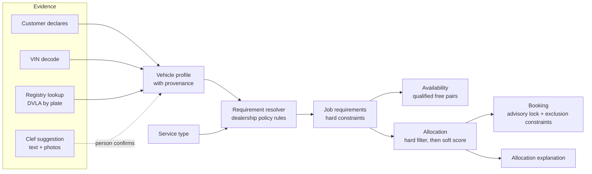
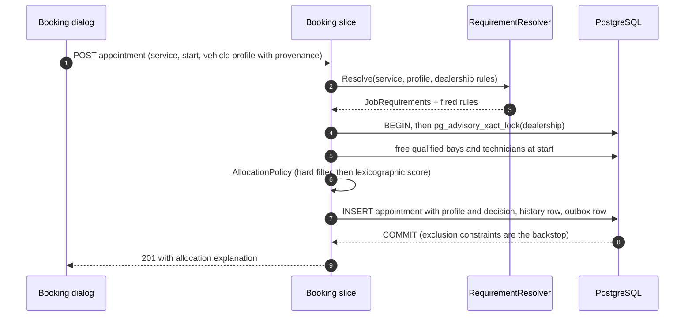
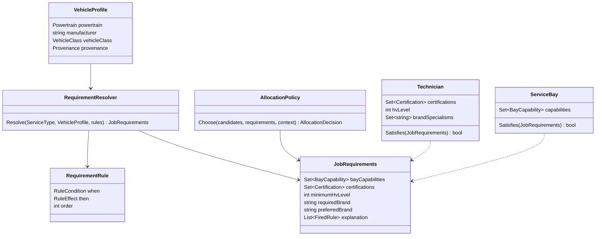

# ADR-029: Vehicle-aware requirements and explainable allocation ("AI proposes, rules decide")

| | |
|---|---|
| **Status** | Accepted (2026-10-12, stakeholder approval). Scope approved for build: Phases 0 and 1, plus the Clef powertrain suggestion once the Clef migration has merged (see "Decisions taken at acceptance") |
| **Deciders** | Khai Pham (stakeholder); design drafted with Claude Opus 5.5 |
| **Builds on** | ADR-001 (vertical slices), ADR-002 (Appointment aggregate), ADR-003 (lock + exclusion constraints), ADR-006 (capabilities as enums), ADR-016 (reflection budget), ADR-026 (closed-set triage with Jev) and ADR-028 (the move to Clef, in progress), ADR-027 (Access + roles, in progress) |
| **Touches** | Domain (requirements, allocation), availability and booking slices, intake triage, reference data, the dispatch board, telemetry |

## At a glance

Today a job's requirements depend only on its **service type**. A brake job needs a standard lift and a Brakes-certified technician, whether the car is a 2009 diesel or a 2026 battery-electric SUV. That is wrong in a way that matters: work on high-voltage (HV) vehicles requires HV-trained people, warranty work often requires brand-trained people, and a heavy van needs a heavy-duty lift whatever the job is.

This ADR makes requirements a function of **(service type, vehicle, dealership policy)**, keeps allocation **deterministic and explainable**, and gives the AI a precise, bounded role: it **proposes** facts about the vehicle and the job when the customer has not given them, with calibrated confidence, and a person confirms them. The AI never chooses a technician and never relaxes a hard constraint.



## Context

### What the model does today

- `ServiceType` carries `RequiredBayCapabilities` and `RequiredCertifications` (ADR-006). `ServiceBay.Supports(serviceType)` and `Technician.IsCertifiedFor(serviceType)` are subset checks.
- `AvailabilityCalculator` intersects the free time of qualified bays and qualified technicians. `AllocationPolicy` then picks one bay and one technician: the preferred one if it is free, otherwise the fewest surplus capabilities (keep specialists free), then the lowest load that day, then name and id.
- PostgreSQL enforces "no double booking" with two partial GiST exclusion constraints, and the booking transaction serialises per dealership with an advisory lock (ADR-003). None of this changes in this ADR.
- Intake triage (ADR-026, moving to Clef in ADR-028) chooses one service and an optional day from a closed set, with calibrated confidence and a human confirmation step.

### The gap, on the seeded Reading workshop

**Seed amendment, 2026-10-12:** the narrative below describes the original competence gap. Fresh Task 31a seeds give Amelia, Chloe and Daniel confirmed level 2, Ben and Eva level 3, and Farid level 1, valid through 2028-12-31. Every seeded Reading service is therefore bookable for ICE and Unknown. Level 4 live diagnosis still has no qualified technician. Existing database levels are preserved; migration only translates the former HV boolean to level 3 unconfirmed.

The customer writes *"Brakes squeal, it's an EV, need it Thursday."* Triage correctly suggests **Brake Pads & Discs** (live golden set, confidence 1.00). The requirements are a standard lift and the Brakes certification, so the allocator may assign **Chloe Nguyen** (Brakes, Wheel Alignment). Nobody asked whether Chloe is trained to work on a high-voltage vehicle. At Reading the only HV-trained technician is **Ben Okafor**, and he holds no Brakes certification.

With this ADR the same request resolves to *Brakes and HV competence at level 2 or above*. No Reading technician meets both, so availability is empty and the API answers `422 no-qualified-resources` with `missingCertifications: ["Brakes"]` paired with `minimumHvLevel: 2`. The system now surfaces a **training gap** the workshop did not know it had, instead of quietly booking an untrained technician onto an HV vehicle.

### Domain facts this ADR relies on

- **EV competence levels (UK, IMI):** level 1 awareness; level 2 routine maintenance, de-energising the HV system and working on the low-voltage side; level 3 repair and replacement of HV components with the system switched off; level 4 diagnosis and repair with the system live, building on level 3. Which level a job needs is the dealership's or OEM's policy, so this ADR models levels and policy, not a hard-coded legal rule.
- **Brand competence:** warranty repairs and OEM diagnostic tools (for example VW ODIS, BMW ISTA) are typically restricted to brand-trained technicians. Keyloop's world is franchised dealerships, so this is the common case, not an edge case.
- **Authoritative vehicle data exists:** the first three VIN characters (the World Manufacturer Identifier, ISO 3780) identify the manufacturer deterministically; the UK DVLA Vehicle Enquiry Service returns `make`, `fuelType`, `typeApproval` (for example M1 car, N1 van), `engineCapacity` and year by registration, with an API key and rate limits, and no keeper data. In production Keyloop's own vehicle master data would be the first source.

## Decision drivers

1. **Safety and legality first.** A hard constraint (HV level, heavy lift) must never be decided by a probability.
2. **The concurrency invariant is untouchable.** Exactly one winner per contested slot, no deadlock, no new contended lock (ADR-003).
3. **Explainable to a dispatcher.** "Why Ben and not Chloe?" must have a one-line answer in the UI and the API.
4. **Deterministic and testable.** Same inputs, same allocation; property tests can state the rules.
5. **Reflection budget (ADR-016).** No reflection-based rules engine; typed rules, source-generated JSON.
6. **Privacy.** VIN and registration are personal data once linked to a person (ADR-027 masking); third-party lookups get the minimum.
7. **Measurable AI.** Every model output that reaches a person is scored by a golden set before it ships.

## Decision

### 1. A vehicle profile with provenance

```text
VehicleProfile (value object, on Appointment and in availability queries)
  Powertrain    : Ice | MildHybrid | FullHybrid | PluginHybrid | BatteryElectric | FuelCell | Unknown
  Manufacturer  : normalised OEM code (from the VIN WMI table), or Unknown
  VehicleClass  : Car (M1) | LightCommercial (N1) | Heavy | Unknown
  Provenance    : per attribute, one of Declared | VinDecoded | RegistryLookup | SuggestedConfirmed
```

Provenance is part of the value, not a log line. It lets the UI show *"EV (from VIN)"* versus *"EV (suggested from the description, confirmed by Sam)"*, and it lets policy refuse to treat an unconfirmed suggestion as a fact.

**Precedence:** RegistryLookup and VinDecoded beat Declared when they disagree, and the disagreement is shown, not silently resolved. A model suggestion becomes `SuggestedConfirmed` only through an explicit click by a signed-in Service advisor or Admin (ADR-027), and it never overrides decoded or registry data.

**Unknown is a real value, and it is conservative.** `Powertrain = Unknown` resolves as if the vehicle were high-voltage. That costs availability, never safety, and booking is not blocked: the UI says why and asks for the VIN. A signed-in advisor may instead **declare** the powertrain with a reason; it is stored with provenance `Declared`, the advisor's identity and the reason, and audited, so the accountability for overriding the conservative default sits with a named person.

### 2. Competence on resources

- `Technician` gains `HvLevel` (0 to 4) and `BrandSpecialisms` (a set of manufacturer codes, GIN-indexed `text[]` like ADR-006). The existing `Certification` enum stays for task skills (Brakes, Diagnostics, MOT, ...); the boolean `HighVoltageElectrical` certification is migrated to **level 3, marked "migrated, unconfirmed"**: that certification already gated HV component work (the battery and charging services), so level 3 is the faithful translation and anything lower would make today's EV services unbookable. The admin area shows a confirmation prompt until a person confirms or corrects each level.
- `ServiceBay` keeps its capabilities. `EvHighVoltage` already exists; nothing new is needed for bays in phase 1.

### 3. Requirement resolution: typed policy rules

`JobRequirements` replaces `ServiceType` as the input to qualification:

```text
JobRequirements
  BayCapabilities      : set          (service type, plus rules)
  Certifications       : set          (service type, plus rules)
  MinimumHvLevel       : 0..4         (rules)
  RequiredBrand        : OEM code?    (rules: warranty or OEM tooling jobs)
  PreferredBrand       : OEM code?    (soft: scored, never filters)
  Explanation          : list of the rules that fired, in order
```

A `RequirementResolver` (pure domain service) applies the dealership's ordered `RequirementRule`s to `(ServiceType, VehicleProfile, appointment date)`. Rules are **typed records stored as reference data, versioned as a policy** (each appointment records the policy version that allocated it), not expressions.

HV exposure differs by job, so the HV rule is a **service-by-powertrain matrix**, not one blanket level. The seeded default policy (each dealership may tighten it):

| Service on an HV vehicle (hybrid, plug-in hybrid, battery electric, fuel cell, or Unknown) | Minimum HV level | Extra requirement | Why |
|---|---|---|---|
| Four-wheel alignment, MOT test | 1 (awareness) | | Never near HV components |
| Interim service, full service, brake pads and discs, diagnostic fault finding | 2 | | Routine work alongside HV cabling; braking interacts with regeneration |
| Air-con regas | 3 | | On electrified vehicles the A/C compressor is itself an HV component |
| EV battery health check, EV charging fault diagnosis | 3 | bay `EvHighVoltage` | HV components, system switched off |
| Any HV job flagged `NeedsLiveDiagnosis` | 4 | bay `EvHighVoltage` | Live working |

Other rules in the default policy:

| Rule | When | Adds |
|---|---|---|
| Heavy vehicle | VehicleClass = Heavy | bay `HeavyDutyLift`, certification `HeavyVehicle` |
| Warranty or OEM tooling | Job flagged Warranty, or service in an OEM-tooling list | `RequiredBrand = vehicle manufacturer` |
| Franchise preference (phase 2) | Manufacturer in the dealership's franchises | `PreferredBrand = manufacturer` (soft) |

**Competences expire, and they are checked on the appointment's date.** IMI registration requires continuing professional development, so `HvLevel` carries `ValidUntil` (and brand specialisms may too). `Technician.Satisfies(requirements, appointmentDate)` uses the level valid **on the local date of the appointment**, not today's: a technician whose level lapses before the job cannot be booked onto it, and the board flags future appointments a lapse would affect.

Why typed rules and not a rules engine: the rule vocabulary is small and closed (a handful of conditions, a handful of effects), every effect maps onto an existing invariant, and typed records keep the reflection budget (ADR-016), exhaustive `switch` coverage, and JSON source generation. A general rules engine (NRules, JSON logic) would add reflection, a second language for policy, and failure modes that tests cannot enumerate.

### 4. Availability and allocation: hard filter, then an explainable score

- `ServiceBay.Satisfies(JobRequirements)` and `Technician.Satisfies(JobRequirements)` replace the service-type checks. Availability is unchanged in shape: it intersects free time of **qualified** resources, and `qualified` now includes the vehicle-driven rules. The `GET /availability` query gains optional `powertrain`, `manufacturer` and `vehicleClass` (or a `vin` resolved server-side), so slot counts are honest before the customer commits.
- `AllocationPolicy` keeps its deterministic shape and gains soft criteria in a fixed lexicographic order:

| Order | Criterion | Why |
|---|---|---|
| 0 | Hard filter (`Satisfies`) | Safety and capability, never traded off |
| 1 | Preferred resource (existing hint) | The advisor's explicit choice |
| 2 | Brand specialist for `PreferredBrand` | Quality and first-time-fix rate |
| 3 | Continuity: the technician who last serviced this VIN | Customer trust, faster diagnosis |
| 4 | Fewest surplus competences, counting HV level as surplus | Keep scarce HV and specialist capacity free (existing rule, extended) |
| 5 | Lowest load that day | Fairness (existing) |
| 6 | Name, then id | Total order, determinism (existing) |

Lexicographic, not weighted: weights invite tuning without evidence and make explanations fuzzy. Each criterion is a comparer, and the allocation returns **which criterion decided**, so the explanation is exact: *"Ben Okafor: only free technician at HV level 3 with Diagnostics"*, *"Amelia Clarke: brand specialist (VW) for a VW vehicle; Chloe Nguyen also qualified"*.

**"Why not" is part of the answer.** When the advisor's preferred bay or technician is not chosen, the response names the rule that excluded it: *"Chloe Nguyen: needs HV level 2 for brake pads and discs on a battery-electric vehicle"*, or *"busy 10:00 to 11:30"*. Dispatchers lose trust in a system that silently overrides them. The same text appears in the board's details sheet.

**Continuity is opt-in.** Criterion 3 (the technician who last serviced this VIN) uses per-vehicle history, a profiling-like behaviour, so it is off unless a dealership switches it on (off in the demo).

### 5. The AI's bounded role in intake (Clef, ADR-028)

New typed questions in the same single Clef request, each with a confirmation step and an explicit downstream effect:

| Question | Type | Used for | May set a hard constraint? |
|---|---|---|---|
| `powertrain` | choice (the enum, plus `UNKNOWN`) | Prefill the profile when there is no VIN or plate | Only after a person confirms, and never against decoded or registry data |
| `safety_critical` | noul | Banner: offer the earliest slot | No |
| `needs_diagnosis_first` | noul | Suggest Diagnostic Fault Finding before the repair | No (the person chooses) |
| `complexity` | score (1 to 4) | Soft preference for higher-competence technicians, and a duration buffer hint the advisor can accept | No |
| `warranty_mentioned` | noul | Ask the advisor to tick Warranty, which fires the brand rule | Only through the tick |

Photos (dashboard warning lights, the charging error screen, a service reminder) are evidence for these questions, inside Clef's documented limits (four images, 4 MiB each, 8 MiB decoded). Reading a VIN or a plate from a photo is **extraction, not classification**: it belongs to a separate, optional OCR step whose output is shown to the person and then decoded deterministically.

### 6. Booking, concurrency and audit

- The booking handler resolves `JobRequirements` **before** taking the dealership lock (pure computation, reference data already loaded), then re-checks qualification and freeness inside the lock exactly as today. No new lock, no new contended row: ADR-003 is untouched.
- `Appointment` stores the `VehicleProfile` (with provenance) and the `AllocationDecision` (deciding criterion and fired rules). The `AppointmentBooked` history event carries both, so an audit can answer *"why was this technician allowed to do this job"* a year later.
- The `AllocationDecision` also records the **policy version** that allocated the job, so an audit reads the policy in force then, not today's.
- If competence data changes after booking (a technician's HV level expires), existing appointments are flagged on the board, not silently moved: reassignment is a human decision (and an admin task, Task 30).
- **Known limitation: two-person live working.** Live HV work often requires a second trained person present. An appointment books one technician today, so the level 4 rule documents the requirement and the board shows a warning; multi-technician appointments are an extension point, not something this ADR fakes.



### 7. API and contract

| Change | Shape |
|---|---|
| Vehicle on booking | `vehicle.profile { powertrain, manufacturer, vehicleClass, provenance{...} }` (optional; absent means Unknown) |
| Availability | optional `powertrain`, `manufacturer`, `vehicleClass`, or `vin` |
| Profile resolution | `POST /api/v1/vehicle-profile:resolve` `{ vin?, registration? }` returns the decoded profile with provenance (registry lookups only for signed-in roles, rate-limited) |
| Allocation explanation | `allocation { decidedBy, reasons[] }` on the booking response and `GET /appointments/{id}` |
| Problems | `no-qualified-resources` gains `minimumHvLevel`, `requiredBrand` and `firedRules[]`; new `vehicle-profile-conflict` (422) when declared and decoded data disagree and the advisor has not chosen |
| Triage | the new typed answers above, each with confidence |



### 8. Data model

| Table | Change | Notes |
|---|---|---|
| `technicians` | `hv_level smallint not null default 0 check (0..4)`, `hv_level_valid_until date null`, `hv_level_confirmed boolean not null default false`, `brand_specialisms text[] not null default '{}'` + GIN | Migration maps `HighVoltageElectrical` to level 3, unconfirmed |
| `requirement_rules` | `dealership_id`, `policy_version`, `order`, typed condition columns (powertrain set, service codes, vehicle class, flags), typed effect columns | Reference data, seeded per dealership, edited in the admin area (Task 30); a change creates a new policy version |
| `appointments` | `vehicle_powertrain`, `vehicle_manufacturer`, `vehicle_class`, `vehicle_profile_provenance jsonb`, `allocation_decision jsonb` | Source-generated JSON (ADR-016); no change to the exclusion constraints |
| `wmi_manufacturers` | `wmi char(3) primary key`, `manufacturer` | Small static table, or a source-generated lookup compiled from a vetted CSV |

## Alternatives considered

| Alternative | Verdict | Reason |
|---|---|---|
| **AI routes technicians directly** | Rejected | Probabilistic choice of who performs safety-critical work; cannot guarantee the invariant; unexplainable; the model is weakest exactly on ambiguous and out-of-scope input |
| **Per-powertrain service variants** (BRAKES-EV, BRAKES-ICE, ...) | Rejected | Catalogue explosion (services x powertrains x classes x brands), duplicated pricing and durations, and every new rule becomes a data migration of the catalogue |
| **General rules engine** (NRules, JSON logic, Drools-style) | Rejected | Reflection and runtime compilation against ADR-016; a second policy language; failure modes that tests cannot enumerate |
| **Weighted scoring for soft preferences** | Rejected for now | Weights need evidence we do not have; lexicographic order is explainable and stable; revisit with real outcome data |
| **Constraint solver / optimiser** (OR-Tools, day-level re-plan) | Deferred | Valuable for re-planning a whole day (sickness, no-shows); overkill for placing one booking; fits a future "optimise tomorrow" admin action |
| **Model-only vehicle facts** (no VIN or registry) | Rejected for hard constraints | Acceptable only as a confirmed suggestion; decoded data is free, deterministic and authoritative |

## Consequences

**Positive**
- Safety: no HV vehicle can be allocated to a technician below the policy's level, by construction.
- Honest availability: slots shown are slots the vehicle can actually be served in.
- Explainability: every allocation states the criterion that decided it and the rules that applied.
- The AI gets more useful without getting more power: richer evidence (text and photos), the same closed-set, confirm-first discipline.
- Surfaces business insight: competence gaps (like Reading's Brakes plus HV gap) show up as `no-qualified-resources` with exact missing competences, an input for training plans.

**Negative and risks**
- Less availability for HV vehicles at under-trained dealerships. Mitigation: the explanation names the gap; the admin area (Task 30) shows it per dealership.
- Reference data must be right. Mitigation: seeded defaults are conservative; competence changes are audited; the board flags affected future appointments.
- Third-party lookups (DVLA) add latency, quotas and a processor. Mitigation: called only on explicit request by signed-in roles, cached per VIN for the booking session only, never for anonymous visitors.
- More surface to test. Mitigation: property tests (below) and the existing adversarial concurrency proof extended with mixed powertrains.

## Verification and evaluation plan

| Layer | What proves it |
|---|---|
| Domain | Property-based tests: for any generated (service, profile, rules, resources), every allocation `Satisfies` the requirements; Unknown never yields fewer constraints than any concrete HV powertrain; resolution is deterministic and order-stable |
| Availability | The existing independent availability oracle extended with competences; DST and boundary cases unchanged |
| Concurrency | The 30-way proof (5 rounds, exactly one 201) with an HV vehicle contending for the only qualified pair, plus a mixed-powertrain round; deadlocks and constraint backstop stay at 0 |
| Allocation | Golden allocation table: 40 scripted cases with the expected technician and the expected `decidedBy`; mutation-probe each criterion |
| AI (Clef) | Golden set extended from 25 to about 80 cases: EV or hybrid with non-HV symptoms, vans, warranty phrasing, safety phrasing, out-of-scope photos, German, injection; report accuracy, abstention, confirmation and override rates per question; thresholds recalibrated per question, not globally |
| Production signals | `scheduler.allocation.decided_by{criterion}`, `scheduler.requirements.rule_fired{rule}`, `scheduler.intake.profile_source{source}`, `scheduler.intake.suggestion_overridden{question}`, and an alert on any allocation whose technician HV level is below the resolved minimum (must be impossible; alerting proves it) |

## Rollout

| Phase | Scope | Flag | Exit criterion |
|---|---|---|---|
| 0 | Competence data: HV levels and brand specialisms on technicians, seeded and editable (Task 30) | none (data only) | Dealership confirms levels |
| 1 | Vehicle profile on booking and availability; offline VIN manufacturer decode (WMI table, no third party); RequirementResolver with the HV matrix and heavy rule; competence expiry on the appointment date; hard filter; explanations including "why not"; policy version on the decision | `Scheduling:VehicleAwareRequirements` | Property tests, concurrency proof, golden allocation table green |
| 2 | Soft criteria: brand specialist, continuity | `Scheduling:SoftPreferences` | Allocation golden table; dispatcher feedback |
| 3 | Clef questions (powertrain, safety, needs-diagnosis, complexity, warranty) with photos | `Triage:VehicleQuestions` | Extended golden set at or above the agreed thresholds |
| 4 | DVLA lookup behind `IVehicleDataSource` (Keyloop vehicle master data in production); off on the public demo | `Vehicle:RegistryLookup` | Privacy review; quota and latency within budget |

Each phase ships independently, behind a flag, with its own ADR amendment if a decision changes.

## Decisions taken at acceptance (stakeholder, 2026-10-12)

| Question | Decision |
|---|---|
| HV policy per job type | A service-by-powertrain matrix (section 3), not one blanket level: alignment and MOT at level 1, routine service, brakes and diagnosis at 2, air-con regas and battery or charging work at 3 (the latter in an EV bay), live diagnosis at 4. Per dealership, seeded with this default. |
| Unknown powertrain | Treated as high-voltage, never blocking; the UI asks for the VIN. An advisor may declare the powertrain with a reason, stored as `Declared` with the advisor's identity, and audited. |
| Existing `HighVoltageElectrical` certification | Migrated to level 3, marked unconfirmed, with a confirmation prompt in the admin area. |
| Registry lookups on the public demo | Off. Phase 1 ships the offline WMI manufacturer decode only; the DVLA adapter stays behind its flag. |
| Continuity (last technician for this VIN) | Opt-in per dealership, off in the demo. |
| Added at review | Competence expiry checked on the appointment's date; "why not" explanations; versioned policy recorded on each allocation; two-person live working documented as a limitation. |
| Scope to build now | Phases 0 and 1, then the Clef `powertrain` suggestion once the Clef migration has merged. Phases 2 to 4 and the other Clef questions stay documented next steps. Sequenced after Task 27 (auth) and the Clef merge, alongside Task 30 (admin editing), because competences need an edit screen. |

## References

- IMI EV qualification levels, as described by training providers and trade press: [What training do you need to work on EVs? (PMM)](https://pmmonline.co.uk/article/what-training-do-you-need-to-work-on-evs/), [IMI Level 4 diagnosis, testing and repair (HyVe)](https://hyvetraining.ac.uk/?p=311).
- DVLA Vehicle Enquiry Service API: [v1.2.0 reference](https://developer-portal.driver-vehicle-licensing.api.gov.uk/apis/vehicle-enquiry-service/v1.2.0-vehicle-enquiry-service.html), [service description](https://developer-portal.driver-vehicle-licensing.api.gov.uk/apis/vehicle-enquiry-service/vehicle-enquiry-service-description.html).
- VIN structure and the World Manufacturer Identifier: ISO 3779 and ISO 3780.
- In this repository: ARCHITECTURE §6 (availability), §7 (concurrency), §8.10 (intake triage), ADR-003, ADR-006, ADR-016, ADR-026, ADR-027.

## Task 31a amendment (2026-10-12)

Phases 0 and 1 ship behind `Scheduling:VehicleAwareRequirements`, default false in every environment. Fresh seed data now gives Reading Amelia, Chloe and Daniel level 2, Ben and Eva level 3, and Farid level 1, all confirmed until 2028-12-31. The Reading brake/HV gap in the original narrative is therefore historical: ordinary Unknown and ICE bookings remain possible for every seeded Reading service. Live HV diagnosis at level 4 remains an honest training gap. Existing technicians are never rewritten by startup seeding. Migration translates `HighVoltageElectrical` to level 3 unconfirmed (every other level stays 0). Review round 1 (2026-10-12): the demo reseed, which already puts the demo back to its starting point, also restores the seeded confirmed levels of seeded technicians whose level was never confirmed, so an upgraded developer database becomes bookable for Unknown brake and MOT work without touching a confirmed level or a non-seeded technician.

The typed default policy includes heavy van service at level 2 for HV/Unknown vehicles, extending the routine-maintenance row. The legacy HV boolean becomes a level 3 floor on component services even for an ICE declaration, named `legacy-hv-component` first in the fired rules (review round 1, 2026-10-12) so that the floor is explained and counted like a policy rule. Requirements only add constraints. Policy ordering is by order, code and id; one version is resolved at a time. An unconfigured dealership uses the same closed default version 1 as the seeded policy.

Task 31a controller refinements: availability never accepts a VIN in the URL. Profile resolution is POST `/api/v1/vehicle-profiles/resolve` with body-only identifiers, BookingsWrite authorization and booking/global rate limiting. A concrete powertrain declaration requires a private 1..500 character reason and the server actor; clients cannot set provenance. `conflictChoice: "UseDecoded"` explicitly acknowledges a conflict while retaining decoded evidence. Explanations persist preferred ids and bounded exclusion reason codes. Unknown inherits every concrete HV tightening rule. Brand specialist preference, continuity, warranty/OEM rules, all Clef questions, registry access, multi-technician allocation and UI are deferred. Task 31b enables Development/Demo together with the UI.

`NeedsLiveDiagnosis` explicitly requests live HV work. Its level 4 and EV-bay requirements apply even alongside an ICE declaration: vehicle classification cannot relax a job explicitly flagged as HV live working. A regression test pins that conservative interpretation.

### Task 31b.0 feature discovery (2026-10-13)

Public `GET /api/v1/features` (`GetFeatures`, `FeatureSwitchesResponse`) returns exactly `{ "vehicleAwareRequirements": false }` or `{ "vehicleAwareRequirements": true }` for this environment. The booking UI must read it before showing the vehicle step, sending vehicle-aware availability filters or showing allocation explanations. Schedule competence fields are hidden from callers without a role even when the flag is on, so their absence cannot reveal the flag. This read grants no write or detail access.

The handler projects only `Scheduling:VehicleAwareRequirements` from the same startup `IOptions<SchedulingOptions>` the scheduling slices use. Changing configuration requires an API restart; hot reload is deliberately unsupported so discovery and enforcement cannot disagree within a process. Successful responses use `Cache-Control: public, max-age=60, must-revalidate` because the value is identical for every caller and contains no personal, dealership or secret data. The one-minute lifetime bounds staleness across restarts; a `422 vehicle-aware-requirements-disabled` still requires the client to refresh discovery and stop sending vehicle-aware inputs. Errors keep `no-store`. The existing global public-read rate limiter applies. All environment defaults remain false until Task 31b ships the UI and enables Development/Demo together.
